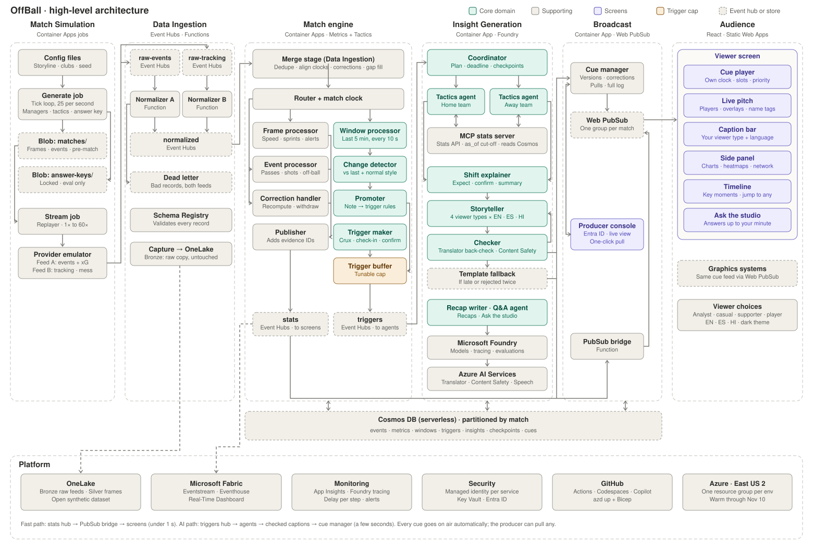
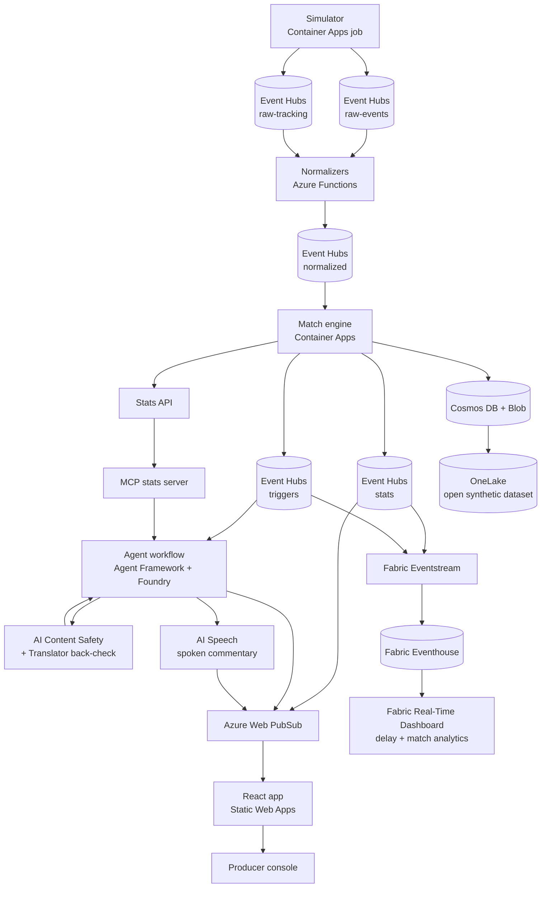

# OffBall: Team Plan

> An AI match engine on Azure that sees where every player is, reads the tactics, notices when they change, and explains it on screen. Visuals come first, with a short story alongside. Built for the **Inside the Game: Developer Hackathon** (Microsoft × Premier League).

**Start here:** [CLAUDE.md](CLAUDE.md) (hub) · [COMPETITION.md](COMPETITION.md) · [High-level design](docs/design/hld.md) · [Low-level designs](docs/design/) · [VERSION.md](VERSION.md)



## Try it (judges, start here)

**Demo video (under 2 minutes):** https://youtu.be/xfnb7fFuq_Q

**What's different:** broadcasts explain the ball; OffBall explains the game off the ball. From
tracking positions it finds decoy runs (who ran, which defenders followed, who got free) and the
free man who isn't found. AI agents predict how a team will react to a goal, red card or
substitution, then confirm or retract it against the numbers. A checker rejects any number not in
the data. Five fan voices (analyst, casual fan, home supporter, away supporter, player) each get
their own stats and their own AI take, in English, Spanish and Hindi.

No sign-in needed except where noted. All clubs, players and matches are fictional and synthetic.

| What | Link |
|---|---|
| **Viewer screen** (recorded matches) | https://jolly-cliff-0ccede51e.4.azurestaticapps.net |
| The 70' red card, analyst view | [open](https://jolly-cliff-0ccede51e.4.azurestaticapps.net/?match=m001&t=4300&type=analyst&lang=en) |
| Before/after board after the red card (74') | [open](https://jolly-cliff-0ccede51e.4.azurestaticapps.net/?match=m001&t=4560&type=analyst&lang=en) |
| The same moment, four ways | [open](https://jolly-cliff-0ccede51e.4.azurestaticapps.net/?match=m001&t=4541&view=four&club=home&lang=en) |
| Supporter view after the red card: attack and defence for your club | [open](https://jolly-cliff-0ccede51e.4.azurestaticapps.net/?match=m001&type=supporter&lang=en&t=4541&club=home) |
| Player view: off the ball (decoy runs, teammates freed) | [open](https://jolly-cliff-0ccede51e.4.azurestaticapps.net/?match=m001&type=player&lang=en&t=4541) |
| **Match control:** start a new match through the live Azure pipeline | https://offball-sim.whitemoss-2f18829c.westus2.azurecontainerapps.io |
| **Producer console:** pull any cue off air during a live match | https://offball-cues.whitemoss-2f18829c.westus2.azurecontainerapps.io/producer |

**1. Watch a recorded match.** Open the viewer, pick a match (Red Card, Comeback, Switch), press ▶, change speed or press **Next moment** (Space plays/pauses, ← → move 10 s). Switch captions between **EN / ES / HI**. Each viewer type has its own captions and its own stats beside the pitch:
- **Casual:** the match so far: shots, on target, share of passes, chances in words, who's running the most.
- **Analyst:** the full tactics panel: before/after board, xG race, shot map, passing, line height, control vs chaos, pressing, passing network.
- **Supporter** (pick a club): attack and defence against the opponent, the standout, who keeps getting free, their danger man.
- **Player** (tap any player): the player card, heatmap and off the ball: decoy runs, defenders pulled, teammates freed, times free but not found.
- **Four ways:** the same moment for four viewer types side by side.

Captions are two or three sentences: what changed, what it means, and an off-the-ball detail. If an old version shows, press **Ctrl+Shift+R**.

**2. Run a live match.** Open match control, pick a storyline, choose a speed and press **Play**. The first Play after a quiet spell wakes the live services, so allow about two minutes. Once it streams, the match appears as **LIVE** in the viewer's match picker, and players, cues and agent captions arrive as the engine computes them. One match plays at a time.

**3. Pull a cue.** During a live match, open the producer console and press **Pull** on any cue; it disappears from every screen. The producer passcode is in our submission form.

**4. Fabric Real-Time Dashboard.** It needs a sign-in to our Fabric tenant, so it's shown in the demo video.

**More detail:** [docs/submission.md](docs/submission.md) has the pitch, how to try it (no login), results numbers, the Microsoft technology used and honesty notes. To run it yourself, open the repo in **GitHub Codespaces** (`.devcontainer/`); local mode needs no Azure.

**Team:** 3 · **Submission deadline:** **Tue Oct 27, 2026, 11:59 pm PT** (Wed Oct 28, 2:59 am ET) · **Winners announced:** by Nov 20

---

## Contents

1. [Read this first: hard rules](#1-read-this-first-hard-rules)
2. [What we're building](#2-what-were-building)
3. [How we'll be judged](#3-how-well-be-judged)
4. [Architecture](#4-architecture)
5. [Software vs. AI vs. Data](#5-software-vs-ai-vs-data)
6. [Tech stack by task](#6-tech-stack-by-task)
7. [Team split: three lanes](#7-team-split-three-lanes)
8. [Shared decisions and contracts (day one)](#8-shared-decisions-and-contracts-day-one)
9. [Lane 1: data engine design](#9-lane-1-data-engine-design)
10. [Lane 2 and Lane 3: design questions](#10-lane-2-and-lane-3-design-questions)
11. [Design doc template](#11-design-doc-template)
12. [Schedule](#12-schedule)
13. [Scope and demo](#13-scope-and-demo)
14. [Submission checklist](#14-submission-checklist)
15. [Risks](#15-risks)
16. [Open questions](#16-open-questions)
17. [Learning resources](#17-learning-resources)

---

## 1. Read this first: hard rules

These come from the official rules and change how we build.

| Rule | What it means for us |
|---|---|
| Submissions close **Oct 27, 11:59 pm PT** | Submit Tuesday afternoon ET, not right at the deadline. |
| Demo video must be **under 2 minutes** | Judges don't have to watch past 2:00. Our original 3-minute demo story is cut down in [section 13](#13-scope-and-demo). |
| No third-party trademarks or copyrighted music in the video | **Fictional clubs and players only, everywhere**, including example captions (no real club names like "Villa"). No music, or royalty-free only. |
| GitHub repo must be **public** | Otherwise the entry isn't considered. |
| Judges must be able to test it **free until judging ends (Nov 10)** | Keep the deployed link up through Nov 10 and budget Azure credits for it. If anything is behind a login, include credentials in the testing instructions. |
| Synthetic data only | No real Premier League data or footage. |
| Submission materials in English | Multilingual output inside the app is fine. |
| Project must be newly built | Everything is built during the hackathon. |
| One **Representative** submits for the team | Pick who this is. |

Judges may score based only on the video and description, so **the video carries a lot of weight**.

---

## 2. What we're building

OffBall is a real-time match-analysis pipeline on Azure. It simulates its own football match: all 22 players and the ball are tracked 25 times a second, plus events like passes, shots and cards. Tactics are secretly scripted into the simulation, so a team really does press, play a high line, or drop deep after a red card. The match is streamed in as two deliberately messy "provider" feeds, which the system cleans, merges, time-aligns and corrects. It then computes stats and tactics from player **positions**, not just events.

Every 15 minutes, and after crux moments (cards, goals, subs, detected shifts), a team of LLM agents explains what changed and why it matters. They first predict ("expect a 4-4-1, deeper line"), then confirm or retract a few minutes later against the numbers. A checker agent blocks any claim the data doesn't support. The output is drawn on a pitch and emitted as timed JSON overlay cues that a broadcast graphics system could render. It goes on air as soon as it passes the checks (a producer can pull any cue) and is personalized for analysts, casual fans, club supporters, single-player followers and different languages.

**What makes it different:**

- **Positions, not just events.** We can measure team shape, off-ball runs and tactics. Competitors we reviewed only use event data.
- **Tactic changes are detected and proven.** Every crux moment runs expect → confirm with a before/after board.
- **Self-scoring.** The generator's hidden answer key lets us measure how accurate our own tactic detection is.
- **Real broadcast problems handled.** Two messy feeds, live corrections, latency tracking, a producer override.

**Design rule: visual first, words second.** Every insight gets a picture on the pitch. The caption only names it.

---

## 3. How we'll be judged

Five equally weighted criteria (20% each):

| Criterion | How we score on it |
|---|---|
| Technological implementation | Clean staged pipeline, infrastructure as code, CI, tests, documented code; real use of every hero tech the rules name: Foundry, Agent Framework, Azure MCP, Copilot Agent Mode, Fabric, GitHub CLI, Azure AI Services, Azure databases (see [section 6](#6-tech-stack-by-task)) |
| Agentic design and innovation | Distinct agents with one job each, our own MCP stats server, checker loop, checkpointing and recovery |
| Real-world impact | Broadcast-ready overlay format, producer override, corrections, a 3-second latency target |
| UX and presentation | Visual-first pitch, the same moment shown four ways, a tight video under 2 minutes |
| Adherence to category | Our pipeline covers all five stages in the brief: ingest, interpret, explain, render, personalize |

**Category prizes** (from the official rules; a project can win one grand prize and one category prize):

| Category | Fit for us |
|---|---|
| Best Multi-Agent System / Orchestration | **Main target** |
| Best Use of Microsoft Foundry Project | Strong: models, agents, evaluations, tracing all in Foundry |
| Best Enterprise Solution | Strong: producer override, managed identities, corrections, audit trail |
| Best Azure Cloud Native Integration | Strong: Container Apps, Functions, Event Hubs, Fabric |

Fabric, Azure AI Services and databases have no prize of their own, but they count toward the Technological Implementation score.

**Category prize target: Best Multi-Agent Orchestration.** Judges check for distinct agent roles, shared state, clean handoffs, recovery from failures, and an outcome a single agent couldn't match. We should show a failure being recovered: kill a step and the workflow resumes from its checkpoint.

---

## 4. Architecture



**The fast path:** live positions and number-only graphics go straight from the match engine to the screen. Agent captions arrive a few seconds later and attach to the same cue ID. Without this we can't hit the ~3-second target, because model calls alone take seconds.

### Pipeline stages

| Stage | What happens | Lane | Main services |
|---|---|---|---|
| Generate | Simulated match, scripted tactics, answer key | 1 | Container Apps job, Blob Storage |
| Ingest | Two messy feeds cleaned, merged, clock-aligned, corrected | 1 | Event Hubs, Azure Functions |
| Interpret | Stats, off-ball metrics, tactics, changes over time | 1 | Container Apps (match engine), Cosmos DB |
| Explain | Agents explain, predict, confirm, check | 2 | Agent Framework, Microsoft Foundry, MCP |
| Show | Pitch visuals, overlay cues, producer console | 3 | React, Web PubSub, Static Web Apps |
| Personalize | Analyst/casual, club, player focus, language | 3 (UI) + 2 (text) | React, storyteller agent |

---

## 5. Software vs. AI vs. Data

**Data produces the truth, Software moves and shows it, AI explains it.**

| Area | What it owns |
|---|---|
| **Data** | Synthetic match generator and answer key; cleaning and merging the feeds; computing every stat and tactic; scoring detection accuracy |
| **Software** | Azure infrastructure (Event Hubs, Functions, Container Apps, Cosmos DB, App Insights); overlay cue format; producer console; live sync to browsers; frontend pitch visuals; personalization modes; deployment, CI and tests |
| **AI** | Agent team (coordinator, tactics agents, shift-explainer, storyteller, checker); narratives, recaps and multilingual captions |

**Core rule: code computes every number, agents only explain.** No number originates from an LLM. Tactic-shift *detection* runs in code (Lane 1). The agent only writes the expect/confirm text.

---

## 6. Tech stack by task

| Task | Tools | Why |
|---|---|---|
| Match generator | Python + NumPy with a fixed random seed, run as a Container Apps job | Same seed gives the same match, so tests are repeatable; writes the answer key alongside |
| Publishing the two feeds | Event Hubs (Standard tier) through its Kafka endpoint | Kafka clients work as-is; one hub per feed |
| Clean, merge, align, correct | Azure Functions (Python, Event Hubs trigger) + Pydantic models as the shared schema | Serverless, event-driven; the schema is the contract |
| Stats and tactics engine | Python service on Container Apps: NumPy/SciPy (Voronoi diagrams for space control), scikit-learn (formation clustering) | Every number, including shift detection, comes from code |
| Match state and history | Cosmos DB for NoSQL (serverless) + Blob Storage (Parquet frames) | Replay, recaps, overlay history, agent checkpoints |
| Stats access for agents | Our own MCP server (Python MCP SDK) wrapping the stats API | Agents can only get numbers through tools; hits the MCP judging criterion |
| Agent orchestration | Microsoft Agent Framework (Python) workflows | Graph workflows with checkpointing |
| Models and agent hosting | Microsoft Foundry project: fast small model for live captions, stronger model for recaps and the checker | Core of the "Best Use of Foundry" prize |
| Quality and safety | Foundry evaluations (groundedness) + Azure AI Content Safety on every caption before it goes on air | Gives us a measurable checker pass rate and a safety gate |
| Languages | Storyteller writes directly in each language; react-i18next for UI text | Multi-language requirement |
| Checking non-English captions | Azure AI Translator translates each non-English caption back to English so the checker verifies the same numbers in every language | Catches a number that changed in translation |
| Spoken commentary | Azure AI Speech (neural voices) reads captions aloud in player-focus and casual modes | Audio option for fans; another AI Service in real use |
| Live analytics and delay dashboard | **Fabric Real-Time Intelligence:** Eventstream reads our existing `stats` and `triggers` hubs (no pipeline change), lands them in an Eventhouse, and a Real-Time Dashboard shows per-stage delay, trigger counts and tactic metrics over the match | Replaces a hand-built delay dashboard; puts Fabric in the real path |
| Open dataset | Generated matches (Parquet frames, events, answer keys) written to a **OneLake** Lakehouse and also attached to a GitHub Release | Covers "expand datasets for AI and analytics" |
| Live push to browsers | Azure Web PubSub (or SignalR Service) | Event Hubs can't reach browsers directly |
| Frontend | React + TypeScript + Vite; pitch in SVG with D3; hosted on Static Web Apps | SVG easily handles 23 objects moving 25 times a second |
| Overlay cue format | Versioned JSON Schema in the repo | Contract any graphics system can read |
| Producer console | Same React app with Entra ID sign-in; live view of every cue with a pull (withdraw) button | Enterprise-style controls |
| Observability | Application Insights + Azure Monitor OpenTelemetry Distro in every service; Foundry tracing for agents | Delay dashboard and agent traces |
| Security | Managed identities everywhere, Key Vault for any remaining secrets | Enterprise readiness |
| Infrastructure and deploy | Azure Developer CLI (azd) + Bicep, so `azd up` deploys everything | Reproducible; judges can rebuild it |
| CI | GitHub Actions: pytest, Playwright end-to-end tests, linting. GitHub CLI posts detection accuracy and checker pass rate as a comment on every pull request | "Quality software practices" criterion; results stay visible |
| Building faster | GitHub Copilot Agent Mode + Azure MCP Server in VS Code; Copilot coding agent assigned small GitHub issues; Copilot code review on pull requests | Hero tech, so document how we used it |
| Easy rebuild for judges | GitHub Codespaces dev container with all tools preinstalled | Judges can open and run it in one click |
| Demo video | Clipchamp or OBS; no music or royalty-free only | Under 2 minutes |

**Not using (and why):**

- **A2A:** support was still landing in Agent Framework 1.0, so it's not worth the risk this week.
- **AKS:** Container Apps already covers it.
- **Logic Apps:** nothing in our pipeline needs it.
- **Stream Analytics:** our Python engine already does the time windowing.
- **Fabric for live processing:** Fabric reads from our pipeline for analytics and the dataset, but the live stats stay in our match engine to keep the 3-second target.

---

## 7. Team split: three lanes

Each person owns one lane end to end, **including its design and architecture**.

| Lane | Stages | Owner |
|---|---|---|
| **1 · Data engine** | Generate, ingest, interpret | _TBD_ |
| **2 · AI and backend** | Explain, narratives, Azure setup | _TBD_ |
| **3 · Experience** | Show, personalize, submission | _TBD_ |

### Lane 1: Data engine

- Match generator with scripted tactics, answer key, 2–3 storyline matches
- Two messy feeds into Event Hubs; normalizers; merge, clock alignment, corrections
- Stats and tactics engine for the four demo tactics: high line and offside trap, pressing, style dial, shift detection
- Detection-accuracy score against the answer key
- Stats API for Lane 2's MCP server
- Details in [section 9](#9-lane-1-data-engine-design)

### Lane 2: AI and backend

- Foundry project, model deployments, Application Insights connection
- MCP stats server wrapping Lane 1's stats API
- Agent Framework workflow:
  - agents: coordinator, tactics agents (one per team), shift-explainer, storyteller, checker (the producer agent is folded into the coordinator);
  - checkpoints stored in Cosmos DB;
  - a failure-recovery demo
- Expect → confirm, half-time and full-time recaps, 2–3 languages
- Groundedness evaluations → checker pass rate
- Azure AI Services: Content Safety gate, Translator back-check for non-English captions, Speech voices
- Open dataset: write generated matches to OneLake and a GitHub Release
- Infrastructure and CI: azd + Bicep, managed identities, GitHub Actions with `gh` result comments, Codespaces dev container

### Lane 3: Experience

- React pitch view: moving dots, name tags, pass arcs, defensive line, pressing rings
- Before/after boards, timeline, producer console
- Web PubSub hookup for live updates
- Personalization: analyst, casual, club supporter, player focus, language
- Fabric Real-Time Dashboard (delay + match analytics) fed by Eventstream; Playwright end-to-end tests
- Speech playback toggle in the UI
- Owns the demo video and the final submission

**Fallback:** if Lane 1 falls behind, Lane 2 takes over the ingest Functions (1B).

---

## 8. Shared decisions and contracts (day one)

Agree on these together **before** anyone designs their lane alone (about an hour).

### Shared decisions

| Decision | Proposal (confirm together) |
|---|---|
| Clock | Everything runs on **match time**, not wall-clock time. Matches can replay at 10× for testing and the demo, and spoiler-free sync becomes nearly free. |
| Coordinates | Metres on a 105 × 68 pitch, origin at one corner, and the home team always attacks toward x = 105 (the second-half flip is handled at ingest). |
| IDs | IDs for every match, team, player, event, insight and cue. |
| Corrections | Same ID, higher `version`. Consumers always keep the highest version. |
| Fast path | Number-only graphics go straight from Lane 1 to the screen; captions attach later by `cue_id`. |
| Caption combinations | For the demo, pre-generate a fixed set of viewer-type × language captions rather than generating per viewer. |

### Contracts

| Contract | Produced by | Used by |
|---|---|---|
| Event and frame schema | Lane 1 | Lanes 2 and 3 |
| MCP tool list | Lanes 1 + 2 together | Lane 2 agents |
| Overlay cue JSON | Lane 2 (captions) + Lane 1 (number-only cues) | Lane 3 |

Lane 1 also exports a **recorded sample match as a JSON file on day one** (even a crude one), so Lanes 2 and 3 can build against realistic data immediately.

After the Thursday review, a contract changes **only if all three agree**.

### Draft schemas (starting point, not final)

**Frame** (positions, batched 5 per message):

```json
{
  "match_id": "m001",
  "frame": 18250,
  "match_clock_ms": 730000,
  "period": 1,
  "ball": { "x": 52.3, "y": 31.0, "z": 0.2 },
  "players": [
    { "player_id": "HOM-07", "team_id": "HOM", "x": 48.1, "y": 22.4 }
  ]
}
```

**Event:**

```json
{
  "event_id": "e-004512",
  "version": 1,
  "match_id": "m001",
  "match_clock_ms": 730120,
  "type": "pass",
  "team_id": "HOM",
  "player_id": "HOM-07",
  "target_player_id": "HOM-10",
  "start": { "x": 48.1, "y": 22.4 },
  "end": { "x": 71.0, "y": 30.2 },
  "outcome": "complete"
}
```

**Overlay cue** (`caption` starts empty; the agents fill it in later):

```json
{
  "cue_id": "cue-0193",
  "version": 1,
  "schema_version": "0.1",
  "match_id": "m001",
  "kind": "line_height_compare",
  "start_clock_ms": 4440000,
  "duration_ms": 12000,
  "anchor": { "x": 26.0, "y": 34.0 },
  "data": { "team_id": "AWY", "before_m": 38, "after_m": 26 },
  "caption": null,
  "status": "proposed"
}
```

Cue `status` moves: `on_air` → `withdrawn` (if corrected or pulled by the producer). Captions are added to a cue already on air.

**Example MCP tools:** `get_line_height(team, window)`, `get_pressing(team, window)`, `get_style(team, window)`, `compare_windows(team, a, b)`, `get_player_stats(player, window)`.

---

## 9. Lane 1: data engine design

### Features grouped by how often they're computed

How often a feature is computed decides where it runs and what state it needs.

| Cadence | Features | Where it runs |
|---|---|---|
| Every frame (25×/s) | Name tags, speed and distance alerts, ball speed, pressure rings | In memory in the match engine (NumPy); straight to the stats hub, no agents |
| Every event | Pass distance, accuracy and difficulty; shot speed; xG range; open options and decision score; decoy runs; auto-eventing from positions | Match engine, runs on each pass, shot or tackle |
| Rolling window (every ~10 s, over the last 2–5 min) | High line and offside trap, pressing, style dial, formation, control vs. chaos, passing network, chance routes | Match engine; snapshots saved to Cosmos DB |
| Triggers | Crux moments, 15-minute check-ins, shift detection, importance score, merging nearby triggers, "confirm due" at +3–5 min | Match engine → triggers hub → Lane 2 agents |
| Offline | Storylines, season history, answer-key scoring, latency reports | Container Apps job + Blob Storage; pytest reports |

### Five modules

| Module | What it contains | Services |
|---|---|---|
| **1A Simulator** | Player movement model; tactic controller (per-team parameters like line height, press trigger distance, pass length that events change); event emitter; two provider writers that add the mess; answer-key writer | Container Apps job (Python); Kafka producer to Event Hubs; storyline configs and answer keys in Blob Storage |
| **1B Ingest** | One normalizer per feed, Pydantic validation, bad records to a dead-letter container | Azure Functions on Flex Consumption with one always-ready instance (avoids cold starts) |
| **1C Match engine** | Front stage merges feeds, aligns clocks, applies versioned corrections; then the frame, event, window and trigger processors | One stateful Container Apps service; Event Hubs partitioned by `match_id`, one replica per match |
| **1D Storage and serving** | Events, window snapshots, triggers, answer keys; raw frames for replay; stats API for the MCP server | Cosmos DB (partition key `match_id`); Parquet in Blob Storage; FastAPI |
| **1E Evaluation** | Detected tactics vs. answer key; timestamps from each stage for the delay dashboard | pytest reports; Application Insights |

**The rule that keeps this simple:** Functions only do stateless, per-message work. Anything that needs memory of earlier frames (speed, windows, merging) lives in the one match engine.

### Event Hubs topics (one Standard namespace)

| Topic | Producer | Consumers |
|---|---|---|
| `raw-events` | Simulator (feed A) | Normalizer A |
| `raw-tracking` | Simulator (feed B) | Normalizer B |
| `normalized` | Normalizers | Match engine (merge stage) |
| `stats` | Match engine | Web PubSub bridge (Lane 3) |
| `triggers` | Match engine | Agent workflow (Lane 2) |

Every topic is partitioned by `match_id`, and each consumer gets its own consumer group.

### Sizing

- 23 objects × 25 frames/s ≈ **575 positions/s per match**.
- Batch 5 frames per message (every 200 ms) → **5 messages/s**. One throughput unit is plenty.
- A full match is **135,000 frames**, so frames go to Blob Storage and Cosmos DB only holds what we query.

### Lane 1 build order

1. **Thu:** simulator with one tactic (high line) + frame tier, so Lane 3 gets moving dots with speeds
2. **Fri:** event tier + red-card trigger
3. **Sat:** window tier (pressing, style dial, shift detection) + answer-key scoring
4. **Sat/Sun:** turn on feed mess and corrections. **Make the mess a config switch** so ingest bugs never block the other lanes.

### Key Lane 1 design questions

- How do teams actually play tactics? Each team has parameters that player rules read every tick, and events change those parameters.
- What "mess" goes into each feed? Candidates: different field names and units, clock offsets, duplicates, dropped records, late corrections.
- Where does match state live, and how fast can a match replay?
- What change, over what time window, counts as a tactical shift?

---

## 10. Lane 2 and Lane 3: design questions

**Lane 2:**

- What does the workflow graph look like: which trigger starts what, where it fans out, and how many times the checker can send a caption back?
- What's the fallback when an agent times out or the checker rejects twice? (A template caption works.)
- Which Cosmos DB containers and partition keys do agents and checkpoints use?
- Which model goes to which agent, given latency and cost?

**Lane 3:**

- Do we send 25 position updates a second to the browser, or 10 and smooth between them?
- Does the client play cues against its own match clock? (This is what makes spoiler-free sync almost free.)
- What does the server personalize (which text variant) and what does the client personalize (which layers show)?
- What does the 2-minute video show? **Storyboard it now** so the UI gets built toward those exact shots.

---

## 11. Design doc template

Each owner writes one page in `/docs/design/lane-N.md`:

```markdown
# Lane N: <name>, design

## What it must do
Functional requirements, plus how fast (latency, rate).

## Components and data flow
Diagram + one line per component.

## Interfaces
What we receive (from whom, which schema) and what we send.

## Key decisions
3–4 decisions, each with the option chosen, the alternative, and the trade-off.

## When things fail
Timeouts, bad data, restarts: what happens.

## Cut / revisit later
What we're not doing, and what we'd change with more time.
```

**Wed Oct 21, evening:** all three docs written. **Thu Oct 22, morning:** 30-minute joint review, then freeze the contracts.

---

## 12. Schedule

| Day | Goal |
|---|---|
| **Wed Oct 21** | Shared decisions, contracts, repo, azd skeleton, sample match file, design docs |
| **Thu Oct 22** | Design review in the morning; build in parallel |
| **Fri Oct 23** | Build in parallel; daily 15-minute sync |
| **Sat Oct 24** | Build; **first end-to-end run on Azure at night** |
| **Sun Oct 25** | Integration and bug fixes; **feature freeze** |
| **Mon Oct 26** | Record video, README, architecture diagram, results numbers |
| **Tue Oct 27** | Buffer; **submit by the afternoon ET** |

---

## 13. Scope and demo

### In scope (must ship)

- Simulated match with scripted tactics and answer key; 2–3 storyline matches with fictional clubs
- Two messy feeds cleaned, merged and aligned; corrections
- Core stats: name tags, speed/distance alerts, pass quality, ball and shot speed, xG range
- Off-ball: open options and decision score, decoy run credit
- **Four demo tactics:** high line and offside trap, pressing, style dial, tactic changes (15-minute check-ins + crux reviews, expect → confirm, before/after)
- Control vs. chaos meter; detection score vs. answer key
- Passing network with before/after; chance routes
- Agent team with checker; recaps; 2–3 languages
- Live pitch screen, overlay cue JSON, timeline
- Personalization: analyst, casual, club, player focus

### Deferred (only if we're ahead by Sunday)

Fake season history · Fair Play referee module · fatigue · space gained / danger window · overloads and rhythm · accessible modes · viewer-chosen overlay layers · spoiler-free sync · playback of missed chances

### Demo video storyboard (under 2:00)

| Time | Shot |
|---|---|
| 0:00–0:15 | Live match: name tags, speeds, pass arcs on the pitch |
| 0:15–0:50 | 70' red card → instant "what to watch for" card → before/after board confirming the line dropped 12 m |
| 0:50–1:20 | The same moment four ways: analyst, casual fan, club supporter in another language, player focus |
| 1:20–1:40 | Behind the scenes: messy feeds cleaned, a correction withdrawing a graphic, delay dashboard, detection score |
| 1:40–1:55 | Architecture and results numbers |

---

## 14. Submission checklist

- [ ] Public GitHub repo with this README, architecture diagram and tests
- [ ] Live deployed link, kept up through **Nov 10**, with testing instructions
- [ ] Demo video **under 2 minutes**, public on YouTube or Vimeo, fictional clubs only, no copyrighted music
- [ ] Project pitch: what we built, which Microsoft and Azure tech, what it does, what problem it solves
- [ ] Results numbers: detection accuracy, end-to-end delay, checker pass rate
- [ ] Honesty note: auto-eventing works from positions, not video
- [ ] README section on how we used GitHub Copilot (Agent Mode, coding agent, code review) and the Azure MCP Server
- [ ] Pitch lists every Microsoft tool used: Foundry, Agent Framework, MCP, Copilot, GitHub Actions and CLI, Codespaces, Fabric (Eventstream, Eventhouse, Real-Time Dashboard, OneLake), AI Content Safety, AI Translator, AI Speech, Cosmos DB, Event Hubs, Functions, Container Apps, Web PubSub, Static Web Apps, Application Insights, Key Vault
- [ ] Screenshot or link of the Fabric Real-Time Dashboard
- [ ] Representative submits on the hackathon site

---

## 15. Risks

| Risk | Mitigation |
|---|---|
| The generator doesn't truly play tactics, so there's nothing to detect | Give it the most time; build one tactic first and verify it's detectable before adding more |
| Scope is too big for one week | Ship every "must" first; defer the list above without debate |
| Latency: agents in the path break the 3-second target | The fast path: number-only graphics never wait for agents |
| Integration happens too late | Contracts on day one, a sample match file on day one, first end-to-end run on Saturday |
| Azure cost through Nov 10 | Serverless and consumption tiers; scale-to-zero where the demo allows |
| No Fabric capacity on our account | Check on day one (Fabric trial capacity if available). Fallback: delay dashboard as an Application Insights workbook, dataset in Blob Storage only |
| Closest rival ("Inside the Game") also reacts to cards with stories | Make it obvious we *measure* how tactics changed and *prove* it |

---

## 16. Open questions

- [ ] Who owns which lane?
- [ ] Who is the Representative who submits?
- [ ] Which 2–3 languages for the demo?
- [ ] Whose Azure subscription or credits, and what's the budget?
- [ ] Do we have Fabric capacity (trial or paid) on that account?
- [ ] Does anyone lean frontend? If not, move the infrastructure work into Lane 3 and keep its UI scope smaller.

---

## 17. Learning resources

AI Skills Navigator playlists for this hackathon:

| Playlist | Who should take it |
|---|---|
| GitHub Copilot | Everyone |
| Microsoft Foundry | Lane 2 |
| Foundry Agents | Lane 2 |
| Agentic Workflows | Lane 2 (coordinator and orchestration) |
| Data | Lane 1; Lane 3 for the Fabric dashboard |
