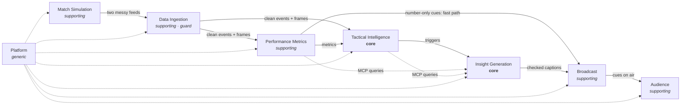
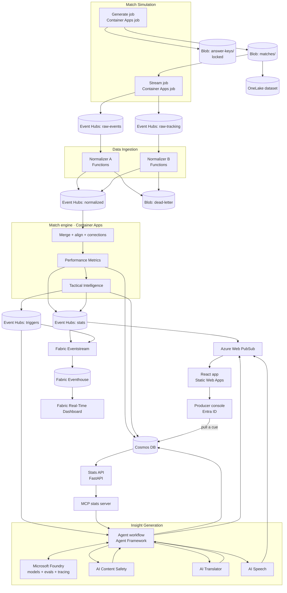
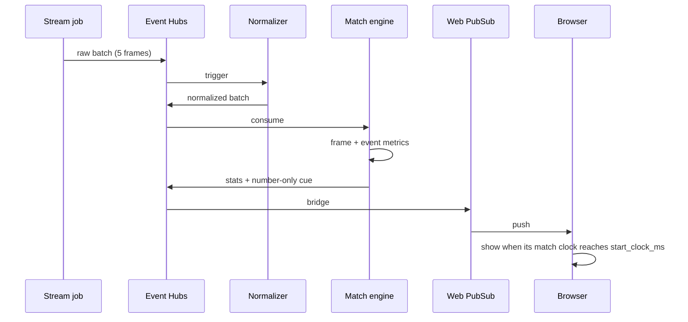
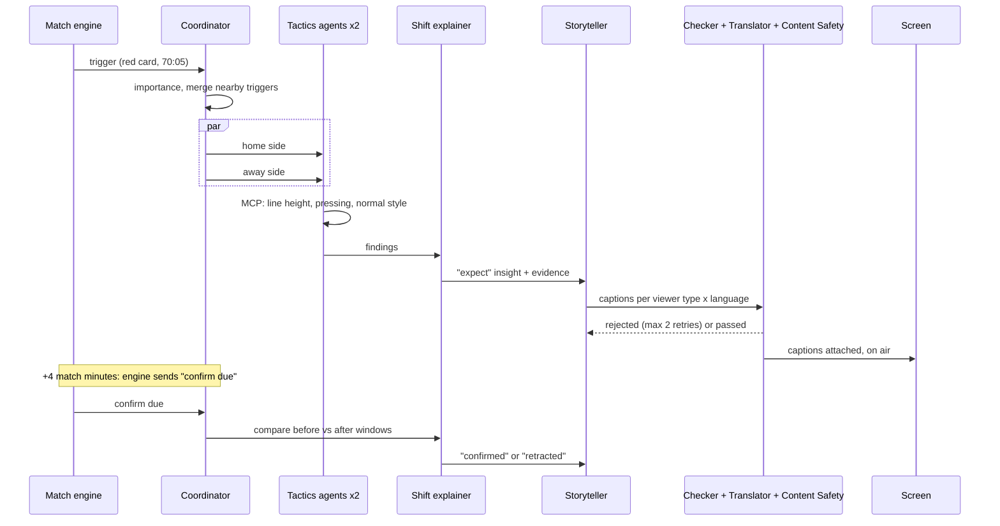
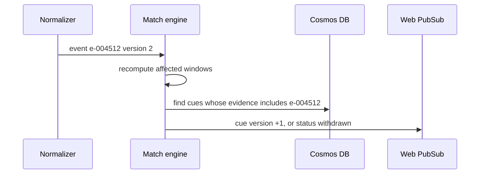

# OffBall: High-Level Design

**Status:** draft v0.1 · **Date:** 2026-10-21 · **Applies to:** whole system
**Companion docs:** one low-level design per domain in `docs/design/lld-*.md` (first: [Match Simulation](lld-match-simulation.md))

---

## 1. Purpose

OffBall simulates a football match, takes it in as two messy provider feeds, works out stats and tactics from player positions, detects when tactics change, and explains it on screen with visuals first and a short caption alongside. It is personalized by viewer type, club, player and language.

This document describes the whole system at the level of domains, Azure services, data flows and key decisions. Each domain's internal design lives in its own low-level design.

## 2. Goals and non-goals

**Goals**
- Cover all five stages of the brief: ingest, interpret, explain, render, personalize.
- Every number on screen is computed by code and traceable to its source events.
- Number-only graphics on screen within 1 second; first agent caption within 8 seconds.
- Detect tactic changes and prove accuracy against a hidden answer key.
- Real use of the named hero technologies: Foundry, Agent Framework, MCP, GitHub Copilot, Fabric, Azure AI Services, Azure databases, cloud-native services.

**Non-goals**
- Real Premier League data, clubs, players or footage.
- Computer vision on video. Auto-eventing works from positions only.
- Generating a unique caption per individual viewer (we use a fixed set of viewer types and languages).
- Scaling beyond a handful of matches at once.

## 3. Requirements summary

### Functional, by domain

| Domain | Must do |
|---|---|
| Match Simulation | Generate repeatable matches with manager identity, scripted tactics, reactions and an answer key; emulate two providers; stream at any speed |
| Data Ingestion | Clean, validate and merge both feeds into one format; align clocks; apply versioned corrections; reject bad records |
| Performance Metrics | Name tags, speed and distance alerts, pass quality, ball and shot speed, xG range, open options, decision score, decoy run credit |
| Tactical Intelligence | Line height and offside trap, pressing, style dial, control vs. chaos, passing network, chance routes, shift detection, 15-minute check-ins, crux-moment triggers, "confirm due", comparison to each team's normal style |
| Insight Generation | Agent team explains, predicts and confirms; checks every claim; writes captions per viewer type and language; recaps |
| Broadcast | Timed overlay cues on air automatically, producer override, corrections reaching the screen |
| Audience | Analyst, casual, club supporter, player focus, single metric, language |
| Platform | Infrastructure, monitoring, delay dashboard, open dataset, CI |

### Non-functional

| Item | Target |
|---|---|
| Number-only graphic on screen | ≤ 1 s from the moment it happens (at 1× speed) |
| First agent caption | ≤ 8 s from a crux moment |
| Follow-up confirmation | 3–5 match minutes after the moment |
| Volume per match | 575 positions/s, about 5 messages/s after batching |
| Replay speed | Up to 10× in demos, 60× in tests |
| Matches at once | 3 |
| Truth | Every on-screen number carries evidence IDs |
| Availability | Deployed and testable for free through Nov 10, 2026 |
| Cost | Serverless and scale-to-zero wherever possible |
| Security | Managed identities on every hop; no keys in code |

## 4. Domains

We split the system by football meaning, not by technology. Each domain owns its data and talks to others only through messages, APIs or MCP tools.



| Domain | Type | Owns | Lane |
|---|---|---|---|
| Match Simulation | Supporting | Match truth, managers, clubs, players, storylines, answer key, provider emulation | 1 |
| Data Ingestion | Supporting (guard) | Feed parsing, clean event and frame format, clock offsets, corrections | 1 |
| Performance Metrics | Supporting | Per-frame and per-event stats, threshold alerts, number-only cues | 1 |
| Tactical Intelligence | **Core** | Time-window snapshots, team shape, normal-style baseline, passing network, chance routes, shifts, triggers | 1 |
| Insight Generation | **Core** | Insights, predictions and confirmations, captions, recaps, evidence | 2 |
| Broadcast | Supporting | Cue life cycle, producer decisions, on-screen timing | 2/3 |
| Audience | Supporting | Viewer profile, focus choices, language | 3 |
| Platform | Generic | Infrastructure, monitoring, Fabric analytics, open dataset, CI | 2/3 |

**Rules between domains**
1. **Own your data.** No domain reads another's storage.
2. **Ingestion is the guard.** Provider formats never pass Data Ingestion.
3. **Few shared contracts.** Only the shared kernel (section 6) is shared; changing it needs all three of us.
4. **Numbers flow one way.** Metrics and Tactical Intelligence create numbers. Insight Generation only explains them.

## 5. Azure architecture



**Match engine note.** Ingestion's merge stage, Performance Metrics and Tactical Intelligence run in one Container Apps service, one replica per match, because they all need memory of recent frames. They remain separate domains in code (separate packages, separate Cosmos containers, no shared objects beyond the shared kernel), so they can be split into separate services later.

### Service list

| Service | Used by | Purpose |
|---|---|---|
| Container Apps (jobs + apps) | Simulation, engine, stats API, MCP server, agent workflow | Compute, scale to zero |
| Azure Functions (Flex Consumption) | Ingestion | Stateless feed normalizers, one always-ready instance |
| Event Hubs (Standard) | All | Message backbone, partitioned by `match_id` |
| Cosmos DB for NoSQL (serverless) | Engine, agents, broadcast | Events, windows, triggers, cues, checkpoints |
| Blob Storage | Simulation, ingestion | Match files, answer keys, dead letters, engine snapshots |
| Microsoft Foundry | Insight Generation | Models, agents, evaluations, tracing |
| Microsoft Agent Framework | Insight Generation | Workflow graph, checkpoints |
| Azure AI Content Safety | Insight Generation | Caption safety gate |
| Azure AI Translator | Insight Generation | Back-translate non-English captions for checking |
| Azure AI Speech | Insight Generation, Audience | Spoken captions |
| Azure Web PubSub | Broadcast, Audience | Live push to browsers |
| Static Web Apps | Audience, Broadcast | React app and producer console |
| Fabric (Eventstream, Eventhouse, Real-Time Dashboard, OneLake) | Platform | Delay and match analytics, open dataset |
| Application Insights + Azure Monitor | Platform | Traces, metrics, logs |
| Key Vault, Entra ID, managed identities | Platform | Security |
| GitHub (Actions, CLI, Codespaces, Copilot) | Platform | CI, results comments, dev environment, building faster |

## 6. Shared kernel and contracts

| Item | Rule |
|---|---|
| Clock | All messages use `match_clock_ms` + `period`. Wall-clock time only appears as `emitted_at` headers for delay measurement |
| Pitch | Metres, 105 × 68, origin at one corner; home team always attacks toward x = 105 (second-half flip handled in Ingestion) |
| IDs | Stable IDs for match, club, manager, player, event, window, trigger, insight, cue |
| Versioning | A correction keeps the same ID with a higher `version`. Consumers keep the highest version |
| Evidence | Every cue and insight lists the `event_ids` and `window_ids` it depends on |

**Published schemas** (versioned JSON Schema in `contracts/`):

| Contract | Producer | Consumers |
|---|---|---|
| Clean event + frame | Data Ingestion | Metrics, Tactical Intelligence |
| Pre-match info (team sheets, manager and club profiles, history) | Data Ingestion (from Simulation) | Tactical Intelligence, Insight Generation, Audience |
| Trigger | Tactical Intelligence | Insight Generation |
| Overlay cue | Metrics (number-only) + Insight Generation (captions) | Broadcast, Audience |
| MCP tools | Metrics + Tactical Intelligence (via stats API) | Insight Generation |

**Overlay cue (v0.2)**

```json
{
  "cue_id": "cue-0193",
  "version": 2,
  "schema_version": "0.2",
  "match_id": "m001",
  "kind": "line_height_compare",
  "start_clock_ms": 4440000,
  "duration_ms": 12000,
  "anchor": { "x": 26.0, "y": 34.0 },
  "data": { "team_id": "NGU", "before_m": 38, "after_m": 26 },
  "evidence": { "event_ids": ["e-004512"], "window_ids": ["w-NGU-60-70", "w-NGU-74-80"] },
  "captions": { "analyst.en": "…", "casual.es": "…" },
  "caption_source": "agent",
  "status": "on_air"
}
```

Every cue goes straight to `on_air`; there is no approval step. It moves to `withdrawn` when a correction removes its evidence or the producer pulls it. Captions are attached to a cue already on air. `caption_source` is `agent` or `template`.

## 7. Main flows

### 7.1 Fast path: numbers to screen (≤ 1 s)



### 7.2 Insight path: crux moment to caption (≤ 8 s)



### 7.3 Corrections



### 7.4 Recovery

- **Agent workflow:** checkpoint saved to Cosmos DB after each step. On restart it resumes from the last checkpoint. This is shown live in the demo.
- **Match engine:** state snapshot to Blob every 30 s; restart replays Event Hubs from the stored position.
- **Functions:** stateless; Event Hubs checkpoints handle restarts.

## 8. Data ownership and storage

| Data | Owning domain | Store | Partition key |
|---|---|---|---|
| Match files, pre-match info | Simulation | Blob `matches/`, OneLake | – |
| Answer keys | Simulation | Blob `answer-keys/` (locked) | – |
| Rejected records | Ingestion | Blob `dead-letter/` | – |
| Raw feeds (Bronze) | Ingestion | OneLake via Event Hubs Capture | – |
| Clean events (versioned, Silver) | Ingestion | Cosmos `events` | `match_id` |
| Clean frames (Silver) | Ingestion | OneLake Parquet | `match_id/period/start_ms` |
| Metric snapshots | Metrics | Cosmos `metrics` | `match_id` |
| Windows, baselines, shifts, triggers | Tactical Intelligence | Cosmos `windows`, `triggers` | `match_id` |
| Insights, recaps | Insight Generation | Cosmos `insights` | `match_id` |
| Agent checkpoints | Insight Generation | Cosmos `checkpoints` | `workflow_id` |
| Cues, producer decisions | Broadcast | Cosmos `cues` | `match_id` |
| Viewer profiles | Audience | Browser local storage (no accounts) | – |
| Delay timings | Platform | App Insights, Fabric Eventhouse | – |

## 9. Delay budget

| Fast path step | Budget |
|---|---|
| Batch 5 frames | 200 ms |
| Event Hubs hops ×2 | 100–200 ms |
| Normalizer | 50 ms |
| Engine metrics | 20 ms |
| Web PubSub to browser | 100 ms |
| **Total** | **≈ 0.5–0.6 s** (target ≤ 1 s) |

| Insight path step | Budget |
|---|---|
| Coordinator | 0.5 s |
| Tactics agents (parallel) | 2 s |
| Shift explainer | 1.5 s |
| Storyteller | 1.5 s |
| Checks | 1.5 s |
| **Total** | **≈ 7 s** (target ≤ 8 s) |

## 10. Scaling and cost

- One engine replica per live match; Event Hubs partitioned by `match_id`.
- One Event Hubs throughput unit covers 3 matches at 10×.
- Container Apps and Functions scale to zero; Cosmos DB serverless.
- Model calls are the main cost. Agents only run on crux moments and 15-minute check-ins (about 15–25 per match). Captions are pre-generated for a fixed set of viewer types × languages. Small model for live captions, larger model for recaps and checking.
- Judge visits replay recorded matches by default; a "run live" button starts a fresh agent run with rate limits.

## 11. Security

- Managed identity for every service; RBAC scoped per hub, container and Cosmos container.
- Answer keys readable only by the evaluation identity.
- Producer console behind Entra ID; a demo account is provided in the testing instructions, plus a read-only public view.
- Key Vault for anything that cannot use a managed identity.
- Rate limits and concurrency caps on public endpoints that call models.

## 12. Observability

- OpenTelemetry in every service (Azure Monitor Distro); Foundry tracing for agents.
- Every message carries `emitted_at`; each stage adds its own timestamp. Fabric Real-Time Dashboard shows delay per stage, trigger counts and tactic metrics.
- Evaluation reports: detection accuracy vs. answer key, checker pass rate, Foundry groundedness scores; posted to each pull request by GitHub CLI.

## 13. Failure handling

| Failure | Behaviour |
|---|---|
| Bad record | Dead-letter; match continues |
| Engine restart | Snapshot + replay from Event Hubs position |
| Agent timeout or checker rejects twice | Template caption from the numbers; `caption_source: template` |
| Content Safety flags a caption | Caption blocked; template used |
| Correction after a cue aired | Cue updated or withdrawn on screen |
| Fabric unavailable | Live system unaffected (Fabric only reads) |
| Model quota exhausted | Template captions; banner in producer console |

## 14. Deployment and environments

- `azd up` deploys everything from Bicep; one environment per developer plus `demo`.
- GitHub Actions: lint, pytest, Playwright, evaluation report comment, deploy `demo` on merge to `main`.
- Codespaces dev container with all tools.
- Every domain also runs locally without Azure using files instead of Event Hubs.

## 15. Key decisions

| # | Decision | Chosen | Alternative | Trade-off |
|---|---|---|---|---|
| 1 | Clock | Match time everywhere | Wall-clock | Replay, sync and tests become simple; needs discipline in every service |
| 2 | Stats location | One stateful engine (three domain packages) | Separate services per domain | Simple state and low delay; split later if needed |
| 3 | Agent access to numbers | Only via MCP tools | Numbers pasted into prompts | Slightly slower; agents cannot invent numbers |
| 4 | Caption timing | Captions attach later to existing cues | Graphics wait for captions | Keeps the 1 s target |
| 5 | Personalization | Fixed viewer types × languages | Per-viewer generation | Cheaper, testable; less individual |
| 6 | Fabric role | Reads from the pipeline | Fabric does live processing | Keeps delay low; Fabric still in real use |
| 7 | Simulation | Generate first, then stream | Generate live | Repeatable demos; no live changes to a running match |
| 8 | Event Hubs client | Native `azure-eventhub` SDK | Kafka endpoint | Simpler managed-identity sign-in |
| 9 | Tactics model | Manager identity → match plan → live changes | Flat settings | Realistic reactions and "unusual for this manager" insights |

## 16. Open questions

- Viewer types × languages to pre-generate (proposal: 4 × 3).
- Exact rule for a tactical shift (proposal: line moves > 6 m or pressing changes > 30% between windows).
- Fabric capacity on our Azure account.
- Owners for each lane and who submits.
