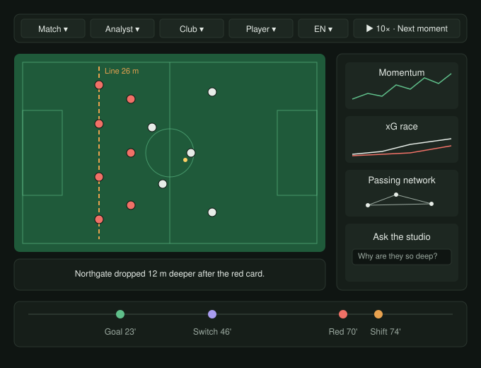

# OffBall: Low-Level Design · Audience

**Status:** approved v1.0 · **Date:** 2026-10-23 · **Owner:** Lane 3
**Parent:** [High-level design](hld.md)

---

## 1. Scope

**What the viewer sees and chooses.** The viewer screen: live pitch, captions, charts, heatmaps, timeline, and the choices that shape it. Delivery, timing and slot scheduling come from [Broadcast](lld-broadcast.md); Audience decides how it all looks.



## 2. Screen rules

1. **The pitch is the hero:** about 70% of the width on a laptop, full width on a phone.
2. **One caption and one highlight** on the pitch at a time (Broadcast slots).
3. **Charts live in the side panel**, never on the pitch.
4. **Viewer type sets the density.**
5. **On demand:** tap a player for their card and heatmap; tap a timeline marker for its before/after board.
6. **Calm motion:** fades of 200–300 ms, no flashing; respects reduced-motion settings.
7. **Dark broadcast theme**, colour-blind-safe team colours.

## 3. Functional requirements

| ID | Requirement | Priority |
|---|---|---|
| AU-1 | Pitch is always the largest element | Must |
| AU-2 | At most one caption and one highlight on the pitch | Must |
| AU-3 | Charts, heatmaps and networks in a side panel | Must |
| AU-4 | Viewer type sets the density | Must |
| AU-5 | Tap a player or timeline marker for detail | Must |
| AU-6 | Calm motion | Must |
| AU-7 | Smooth player and ball movement | Must |
| AU-8 | Name tags; speed tag on alerts | Must |
| AU-9 | Pass arcs coloured by difficulty; shot speed | Must |
| AU-10 | Defensive line with distance, pressing rings, team shape outline | Must |
| AU-11 | Open options with ghost arrow to the best option; decoy runs | Must |
| AU-12 | Before/after board for crux moments | Must |
| AU-13 | Momentum / control vs. chaos chart | Must |
| AU-14 | Line height and pressing over time with tactic-change markers | Must |
| AU-15 | xG race | Must |
| AU-16 | Shot map sized by xG | Must |
| AU-17 | Passing network | Must |
| AU-18 | Player heatmap and team territory heatmap | Should |
| AU-19 | Speed and distance leaders | Should |
| AU-20 | Chance routes | Should |
| AU-21 | Timeline of goals, cards, subs, tactic changes, insights | Must |
| AU-22 | Tap a marker to jump there or open its board | Must |
| AU-23 | Viewer type: analyst, casual, club supporter, player focus | Must |
| AU-24 | Club choice: supporter framing and colours | Must |
| AU-25 | Player to follow: highlighted, own panel, own check-ins | Must |
| AU-26 | Language: English, Spanish, Hindi | Must |
| AU-27 | Single-metric mode | Should |
| AU-28 | Choices remembered on this device, no account | Must |
| AU-29 | Ask the studio box; answer in the side panel | Should |
| AU-30 | Answers use only the match up to the viewer's minute | Should |
| AU-31 | Match picker: three storylines | Must |
| AU-32 | Play, pause, 1× / 10×, next key moment | Must |
| AU-33 | Shareable link to any moment | Should |
| AU-34 | Side-by-side mode: same moment, four viewer types | Must |
| AU-35 | Colour-blind-safe palette, readable on phones | Should |
| AU-36 | Calm mode | Nice |
| AU-37 | Laptop and phone layouts | Must |
| AU-38 | 60 frames a second on a normal laptop | Must |

## 4. Layout

| Area | Laptop | Phone |
|---|---|---|
| Top bar | Match, viewer type, club, player, language, playback | Collapses into one menu button + playback |
| Pitch | Left, ~70% width | Full width |
| Caption bar | Under the pitch | Under the pitch |
| Side panel | Right, ~30% width | Bottom sheet, swipe up |
| Timeline | Full width at the bottom | Full width at the bottom |

## 5. Viewer types

| Type | Visible | Captions |
|---|---|---|
| Casual | Pitch, caption bar, timeline; side panel closed | `casual.{lang}` |
| Analyst | All of the above + side panel open (momentum, line/pressing, xG race, network) | `analyst.{lang}` |
| Club supporter | Like casual, in the club's colours | `supporter_home` or `supporter_away` |
| Player focus | Player highlighted with a ring; side panel shows player card, heatmap, check-ins | `casual.{lang}` + player check-ins |

**Single-metric mode:** the viewer picks one measure (pressing, line height, speed, xG); every other overlay and chart is hidden, and that measure gets a large live readout plus its chart.

**Side-by-side mode:** a 2 × 2 grid of small pitches with caption bars, one per viewer type, locked to the same match clock. Used for the demo shot.

## 6. Pitch drawing

- Drawn in SVG with D3, coordinates in metres (105 × 68) scaled to the container.
- Positions arrive 25 times a second in batches; the renderer interpolates between frames at the screen's refresh rate.
- Layers, bottom to top: pitch, team shape outline, defensive line, players and ball, name tags, highlight (one), labels.
- Overlays by cue kind:

| Cue kind | Drawing |
|---|---|
| `pass_arc` | Curved line, colour by difficulty (green easy → amber → red hard) |
| `speed_alert` | Tag above the player with km/h, fades after 3 s |
| `line_height_compare` | Dashed line with distance label; before line faint |
| `pressing` | Rings around pressers closing on the carrier |
| `best_option` | Ghost arrow from passer to the best option |
| `decoy_run` | Runner's path with arrows from defenders being pulled |
| `before_after` | Two mini pitches side by side in the pitch area |
| `tactical_note` | Small label at the relevant spot, fades after 5 s |

## 7. Charts (side panel)

| Chart | Type | Data |
|---|---|---|
| Momentum / control vs. chaos | Line over match time, event markers | Tactical Intelligence window series |
| Line height and pressing | Two lines with tactic-change markers | Tactical Intelligence window series |
| xG race | Step lines for both teams | Performance Metrics shots |
| Shot map | Half pitch, dots sized by xG | Performance Metrics shots |
| Passing network | Nodes at average positions, link width by passes | Tactical Intelligence |
| Player heatmap | 21 × 14 grid on the pitch | Performance Metrics (PM-29) |
| Team territory | Two heatmaps, in and out of possession | Tactical Intelligence (TI-35) |
| Leaders | Bar list: top speed, distance | Performance Metrics |
| Chance routes | Three lane bars, left/centre/right | Tactical Intelligence |

Charts built with D3 to match the pitch. Every chart uses theme colours and tabular numbers.

## 8. Theme

| Token | Use |
|---|---|
| Background `#0f1512`, panels `#161e19` | Screen and panels |
| Text `#e6ece7`, muted `#9aa89f` | Labels |
| Pitch `#1f5a3a`, lines `#5fbf8a` | Pitch |
| Highlight `#e8a24f` | The one active highlight |
| Teams | Chosen from a colour-blind-safe pair (e.g. white vs. coral) |

Fonts: a condensed display face for scores and labels, a clean sans for captions, monospace digits for numbers.

## 9. State and preferences

- Viewer choices (type, club, player, language, single metric) stored in local storage; defaults: casual, no club, English.
- Shareable link format: `/?match=m001&t=70:05&type=analyst&lang=es`.
- No accounts. The producer console is separate (see Broadcast).

## 10. Code layout

```
web/
  src/
    App.tsx
    viewer/        TopBar.tsx, Pitch.tsx, CaptionBar.tsx, SidePanel.tsx, Timeline.tsx,
                   SideBySide.tsx, SingleMetric.tsx, AskStudio.tsx
    pitch/         layers/, overlays/, interpolate.ts
    charts/        Momentum.tsx, LinePressing.tsx, XgRace.tsx, ShotMap.tsx,
                   PassNetwork.tsx, Heatmap.tsx, Leaders.tsx, ChanceRoutes.tsx
    broadcast/     (cue player, see Broadcast)
    i18n/          en.json, es.json, hi.json
    theme.css
  tests/           Playwright end-to-end
```

React + TypeScript + Vite, hosted on Azure Static Web Apps.

## 11. Tests

| Test | Pass condition |
|---|---|
| One highlight | Two overlay cues at once never both appear on the pitch |
| Viewer types | Switching type changes visible areas and caption keys |
| Language | Hindi selected: captions and screen text in Hindi |
| Player focus | Followed player ringed; panel shows their stats |
| Side-by-side | Four views show the same match minute |
| Phone | At 390 px wide: no sideways scroll, side panel as bottom sheet |
| Performance | 60 fps on the pitch during 10× playback on a mid-range laptop |
| Shareable link | Opening a link lands on that minute, type and language |

## 12. Build order

| Day | Deliverable |
|---|---|
| Thu | Pitch with moving dots and name tags from the sample match; top bar; dark theme |
| Fri | Caption bar, timeline, overlays (pass arcs, line, speed tags); cue player hookup |
| Sat | Side panel charts (momentum, line/pressing, xG race, shot map, network); viewer types; languages |
| Sun | Side-by-side mode, player focus, Ask the studio, heatmaps, phone layout, Playwright tests |
