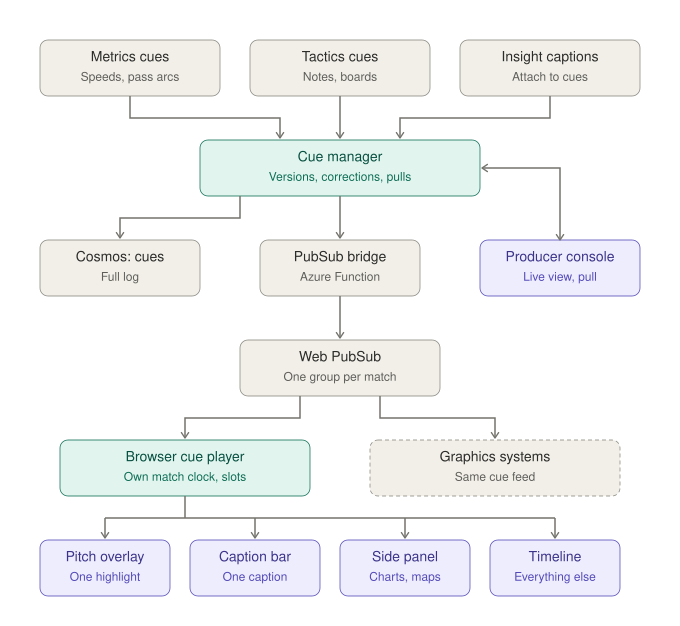

# OffBall: Low-Level Design · Broadcast

**Status:** approved v1.0 · **Date:** 2026-10-23 · **Owners:** Lane 2 (server) + Lane 3 (browser player, producer console)
**Parent:** [High-level design](hld.md)

---

## 1. Scope

**Getting every graphic and caption onto screens at the right moment, without clutter.** Broadcast takes cues from Performance Metrics, Tactical Intelligence and Insight Generation, keeps the single true list of cues, delivers them to every browser and graphics system, and lets the producer pull anything. Delivery to browsers lives here; Audience is purely what the viewer sees and chooses.



**Key choice:** the **server** owns the truth (cues, versions, corrections, pulls). **Each browser schedules for itself**, because every viewer can be at a different point in the match. Same rules, applied per viewer.

## 2. Users

| Role | Who | Uses |
|---|---|---|
| Producer | Studio or broadcaster staff (in the demo: one of us; judges via a demo login) | Producer console: watch every cue, pull any |
| Viewer | Fans | Viewer screen (see Audience) |
| Graphics system | A broadcaster's own graphics engine | Cue feed |

## 3. Functional requirements

| ID | Requirement | Priority |
|---|---|---|
| BR-1 | Accept cues from all three upstream domains in the shared cue format | Must |
| BR-2 | Every cue goes on air automatically; no approval step | Must |
| BR-3 | Attach late-arriving captions to the cue already on air (new version) | Must |
| BR-4 | Corrections update a cue, or withdraw it if its evidence was deleted | Must |
| BR-5 | Screen slots: pitch overlay, caption bar, side panel, timeline | Must |
| BR-6 | One caption and one highlight graphic on the pitch at a time | Must |
| BR-7 | Priority decides who gets a busy slot; the loser queues or goes to the timeline | Must |
| BR-8 | Cues that would show more than 10 s after their moment go to the timeline | Must |
| BR-9 | Name tags, ball and players are always-on layers outside the queue | Must |
| BR-10 | Push stats and cues to every browser watching a match | Must |
| BR-11 | Spoiler-free: each browser shows a cue when its own match clock reaches the cue time | Must |
| BR-12 | Late joiners and viewers who jump to a moment get current state plus cues since then | Must |
| BR-13 | Each viewer receives only their viewer type and language captions | Should |
| BR-14 | Producer console: live view of every cue with status and caption source | Must |
| BR-15 | One-click pull, logged with who and when | Must |
| BR-16 | Health panel: feeds, delay per step, model fallback banner | Should |
| BR-17 | Entra ID sign-in; demo account for judges; public read-only view | Must |
| BR-18 | Cue format published as versioned JSON Schema | Must |
| BR-19 | Cue feed for external graphics systems | Must |
| BR-20 | WebVTT export of cues | Nice |
| BR-21 | Full log of every cue version and why it came off air | Must |
| BR-22 | Delay from match moment to browser, per cue kind | Must |
| BR-23 | Run locally without Azure | Must |

## 4. Non-functional requirements

| Area | Target |
|---|---|
| Delay | Cue manager adds ≤ 50 ms; Web PubSub to browser ≤ 150 ms |
| Scale | 100 concurrent viewers per match in the demo (Web PubSub free/standard tier) |
| Pull | A pulled cue disappears on every screen within 1 s |
| Late join | Current state on screen within 2 s of opening a match |

## 5. Cue life cycle

```
created (on_air) ──caption added──→ on_air (version +1)
       │                                 │
       ├──correction changes data────────┤ (version +1)
       │
       └──evidence deleted / producer pull──→ withdrawn
```

There is no `proposed` or `approved` state. `withdrawn` keeps a `reason`: `correction` or `producer_pull`.

## 6. Cue kinds, slots and priority

| Priority | Kinds | Slot |
|---|---|---|
| 1 | `goal`, `red_card` | Pitch overlay + caption bar |
| 2 | `insight` (expect, confirmed, check-in, summary), `line_height_compare`, `before_after` | Pitch overlay + caption bar |
| 3 | `tactical_note`, `decoy_run`, `best_option` | Pitch overlay |
| 4 | `pass_arc`, `shot_speed`, `speed_alert`, `distance_milestone` | Pitch overlay |
| – | `xg_summary`, `passing_network`, `style_dial`, `control_meter`, charts, heatmaps | Side panel |
| – | Everything that loses a slot or is stale | Timeline |
| always on | `name_tags`, players, ball | Pitch base layer |

**Browser scheduling rules:** a higher-priority cue replaces a lower one in its slot (the replaced cue goes to the timeline); equal priority queues for up to 3 s, then goes to the timeline; cues more than 10 s late go straight to the timeline.

## 7. Server components

| Component | Runs on | Job |
|---|---|---|
| Cue manager | Container App | Receives cues and caption versions; applies corrections; handles pulls; writes the log; publishes to Web PubSub |
| Cosmos `cues` | Cosmos DB | Every version of every cue; partition `match_id` |
| PubSub bridge | Azure Function (Event Hubs trigger on `stats`) | Forwards the stats stream to Web PubSub |
| Web PubSub | Azure Web PubSub | One group per match (`match-m001`); viewers join their match group |
| State endpoint | Cue manager | `GET /matches/{id}/state?at=mm:ss` returns current snapshot and cues since then, for late joiners and jumps |

## 8. Browser cue player

| Part | Job |
|---|---|
| Match clock | Runs at the viewer's playback speed and position |
| Inbox | Holds received cues sorted by `start_clock_ms` |
| Scheduler | Releases cues when the clock reaches them; applies slots, priority and stale rules |
| Filter | Picks captions for the viewer's type and language (`{type}.{lang}`) |

## 9. Producer console

- Table of cues for the match: time, kind, slot, status, caption source (agent / template), latency.
- **Pull** button per cue; confirmation in the page; sends `POST /cues/{id}/pull`.
- Health strip: feed status, delay per step, template-fallback banner.
- Entra ID sign-in; demo account in the testing instructions; public read-only version without the pull button.

## 10. External graphics systems

- Cue format: `contracts/cue.schema.json` (versioned).
- Subscribe to the same Web PubSub group with a read-only token, or read the cue log.
- Optional WebVTT export per match: `GET /matches/{id}/cues.vtt`.

## 11. Code layout

```
broadcast/
  cue_manager/        app.py, corrections.py, pulls.py, state.py, log.py
  pubsub_bridge/      function_app.py
web/src/broadcast/
  clock.ts, inbox.ts, scheduler.ts, filter.ts
web/src/producer/
  ProducerConsole.tsx
contracts/
  cue.schema.json
```

## 12. Tests

| Test | Pass condition |
|---|---|
| Priority | A red card replaces a speed alert; the alert lands on the timeline |
| One per slot | Two insights at once: one shows, one queues then moves to the timeline |
| Stale | A cue arriving 12 s late goes to the timeline |
| Spoiler-free | A viewer 30 s behind sees the goal cue at their own 70:05 |
| Pull | Pulled cue gone from all test browsers within 1 s; logged |
| Correction | Deleted evidence withdraws the cue with reason `correction` |
| Late join | Opening at 72:00 shows current state and cues since 67:00 |

## 13. Build order

| Day | Deliverable |
|---|---|
| Fri | Cue schema; cue manager with log; PubSub bridge; browser inbox and clock |
| Sat | Scheduler (slots, priority, stale); captions filter; corrections and withdraw |
| Sun | Producer console with pull; state endpoint; delay measurement |
