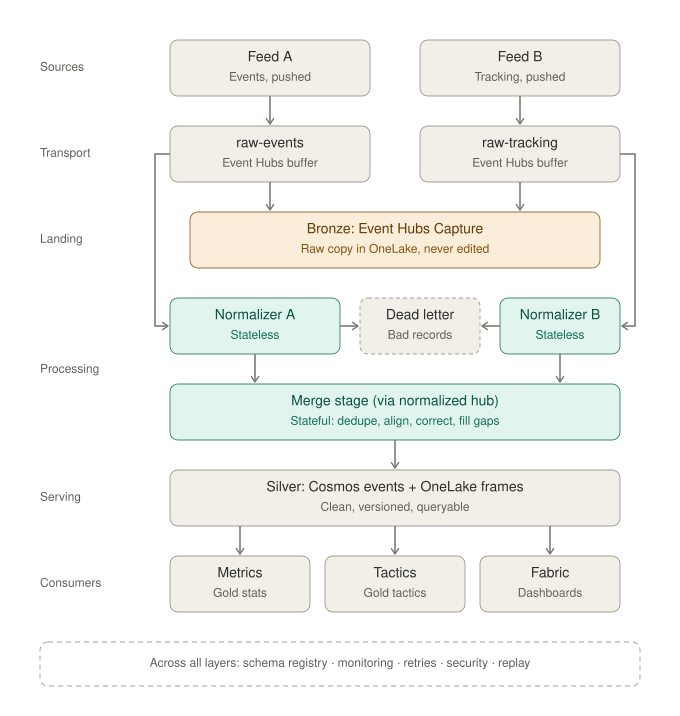

# OffBall: Low-Level Design · Data Ingestion

**Status:** approved v1.0 · **Date:** 2026-10-22 · **Owner:** Lane 1
**Parent:** [High-level design](hld.md)

---

## 1. Scope

Data Ingestion is the guard at the door. Two foreign, messy feeds come in; one clean, trustworthy version of the match comes out. Nothing after this domain sees a provider format.

In data-engineering terms it turns **Bronze** (raw) into **Silver** (clean). Performance Metrics and Tactical Intelligence turn Silver into Gold.



| Part | Where it runs | Why |
|---|---|---|
| Bronze landing | Event Hubs Capture | Built-in, no code; raw copy for replay and audit |
| Normalizers A and B | Azure Functions | Translating one message needs no memory |
| Merge stage | Inside the match engine | Dedupe, ordering, clock alignment and gap fill need memory |

**Design pattern:** stream-only (Kappa), at-least-once delivery made safe by idempotent dedupe, raw-first (ELT).

## 2. What streams in

| Feed | Hub | Content | Rate |
|---|---|---|---|
| A (event style) | `raw-events` | Pre-match info, events with qualifiers and provider xG, period markers, match conditions, stoppages, corrections, deletions | ~2,000–3,000 messages per match |
| B (tracking style) | `raw-tracking` | Ball + 22 players, 25 frames/s, batched 5 per message | 5 messages/s |

## 3. Functional requirements

| ID | Requirement |
|---|---|
| FR-0 | Save every raw message unchanged (Bronze) via Event Hubs Capture to OneLake |
| FR-1 | Receive both feeds continuously |
| FR-2 | Keep matches separate (partition by `match_id`) |
| FR-3 | Work at 1×–60× replay speed |
| FR-4 | Positions → metres on 105 × 68 |
| FR-5 | Home team always attacks toward x = 105 |
| FR-6 | Both clocks → `match_clock_ms` + period |
| FR-7 | Provider IDs and shirt numbers → our player IDs via the team sheet |
| FR-8 | Provider event types, qualifiers and xG → our event schema |
| FR-8b | Match conditions and stoppages → our conditions events |
| FR-9 | Validate every record against the registered schema |
| FR-10 | Failed records → dead-letter with reason; match continues (includes unknown player IDs) |
| FR-12 | Remove duplicate events and frames |
| FR-13 | Reorder late events within a 1.5 s wait window; later ones become late inserts |
| FR-14 | Align feed A's clock to feed B's |
| FR-15 | Fill tracking gaps ≤ 0.5 s; mark longer gaps as missing |
| FR-16 | Detect and fix wrong units in tracking |
| FR-17 | Changed event → same ID, higher version |
| FR-18 | Deleted event → `status: deleted` |
| FR-19 | Announce every change and deletion downstream |
| FR-20 | Hand clean frames and events to Metrics and Tactical Intelligence |
| FR-21 | Store every clean event, all versions |
| FR-22 | Pass on pre-match info |
| FR-23 | Announce data conditions: gap, feed stopped/resumed, correction applied |
| FR-24 | Count duplicates, corrections, deletions, rejects, gaps, clock offset |
| FR-25 | Timestamp each step for delay measurement |
| FR-26 | After a match, score cleaned data against the simulator's truth |
| FR-27 | Restart without losing or double-counting |
| FR-28 | Keep going if one feed stops, and flag it on the dashboard |
| FR-29 | Run locally from feed files without Azure |

## 4. Non-functional requirements

| Area | Target |
|---|---|
| Delay, frames | ≤ 100 ms added per batch |
| Delay, events | ≤ 1.5 s wait window (event-based graphics land in ~2–2.5 s) |
| Throughput | 3 matches at 10× without falling behind |
| Correctness | ≥ 99% of true events recovered at `light` mess; clock alignment error ≤ 80 ms |
| Idempotent | Re-delivering any message changes nothing |
| Restart | Back to live within 30 s, no lost events |
| Security | Normalizers read raw hubs only, write `normalized` and dead-letter only; no answer-key access |
| Cost | Functions on Flex Consumption, one always-ready instance |

## 5. Mess and how it's handled

`light` is the demo default; `full` is for tests and the behind-the-scenes demo shot.

| Feed | Mess | Amount | Fix | Level |
|---|---|---|---|---|
| A | Duplicates | 2% | Drop by provider event ID + version | light |
| A | Late corrections | 3% | Version bump → recompute downstream | light |
| A | Deletions | 0.5% | `status: deleted` → withdraw dependent cues | light |
| A | Clock offset | 0.5–2.0 s | Clock alignment (§6.3) | light |
| A | Direction flip at half-time | always | Normalizer flips by period + team | light |
| A | Out of order (≤ 3 s late) | 5% | Wait window; later = late insert | full |
| A | Broken records | 0.2% | Dead-letter | full |
| B | Dropped frames | 0.5% + one 2 s gap | Fill ≤ 0.5 s; mark longer | light |
| B | Duplicate batches | 1% | Drop by frame number | light |
| B | Position noise ±10 cm | always | Left as is; Metrics smooths speeds | light |
| B | Wrong units | rare | Range check → rescale | full |

## 6. How it works

### 6.1 Normalizer (per message, stateless)
1. Parse JSON; validate against the schema from Event Hubs Schema Registry.
2. Map IDs: feed A player IDs and feed B shirt numbers → our IDs using the cached team sheet.
3. Convert coordinates to metres; flip direction for the second half.
4. Convert clock to raw match time (feed A offset not yet corrected).
5. Map types and qualifiers to our schema.
6. Publish to `normalized` (partition key `match_id`), keeping `source_ids` and `emitted_at`.
7. On any failure: write to dead-letter with the stage and reason.

### 6.2 Merge stage (stateful, in the match engine)
1. **Dedupe:** remember `(source_id, version)` seen in the last 5 minutes; drop repeats.
2. **Order:** hold events in a 1.5 s wait window sorted by match time; release in order. Events arriving later are released at once as late inserts.
3. **Align:** apply the current feed A offset (§6.3).
4. **Correct:** a new version of a known event → replace, emit `event.upsert`; a deletion → emit `event.delete`.
5. **Fill:** for missing frames ≤ 0.5 s, interpolate positions linearly and set `interpolated: true`; longer gaps emit `notice.gap_start` / `notice.gap_end`.
6. **Units:** if a batch's positions fall outside the pitch by a factor near 100, rescale.
7. Hand clean messages to the router (Performance Metrics) and store them (§8).

### 6.3 Clock alignment
1. **Kickoff anchor:** first frame where the ball leaves the centre spot = kickoff event.
2. **Pass anchors:** for each pass, find the ball-speed jump in tracking within ±3 s near the pass location.
3. Offset = rolling median of anchor differences (last 30 anchors).
4. The simulator's true offset is in the answer key, so alignment error is scored.

### 6.4 Feed health
If no message arrives on a feed for 3 s of wall time while the other is active, emit `notice.feed_stopped`; emit `notice.feed_resumed` when it returns. The match continues on the remaining feed.

## 7. Data model (Silver)

**Clean event**
```json
{
  "event_id": "e-004512",
  "version": 2,
  "status": "active",
  "match_id": "m001",
  "match_clock_ms": 730120,
  "period": 1,
  "type": "pass",
  "team_id": "RIV",
  "player_id": "RIV-07",
  "target_player_id": "RIV-10",
  "start": { "x": 48.1, "y": 22.4 },
  "end": { "x": 71.0, "y": 30.2 },
  "outcome": "complete",
  "qualifiers": [],
  "provider_xg": null,
  "source_ids": { "feed_a": 4512 },
  "emitted_at": "2026-10-22T14:03:11.204Z"
}
```

**Clean frame batch:** `match_id`, `period`, `frames[]` of `{ frame, match_clock_ms, ball {x,y,z}, players [{player_id, x, y}], interpolated }`.

**Notices:** `event.upsert`, `event.delete`, `notice.gap_start`, `notice.gap_end`, `notice.feed_stopped`, `notice.feed_resumed`, `conditions.changed`, `stoppage.start`, `stoppage.end`.

## 8. Storage

| Data | Store | Key |
|---|---|---|
| Bronze, both feeds | OneLake via Event Hubs Capture (Avro), 7-day retention | by hub and time |
| Silver events (all versions), pre-match, conditions | Cosmos DB `events` | partition `match_id`, id `event_id:version` |
| Silver frames | OneLake Parquet, one file per match per 5 minutes | `match_id/period/start_ms` |
| Dead letters | Blob `dead-letter/` | `match_id/stage/time` |
| Counts and delays | Application Insights + Fabric Eventhouse | – |

## 9. Triggering

Nothing polls. Event Hubs pushes each message to the engine's consumer, which calls the merge stage and then the router directly:

```python
async def on_message(partition_context, raw):
    for clean in merge.handle(raw):
        for result in router.dispatch(clean):
            await publisher.emit(result)
        clock.advance(clean.match_clock_ms)
    await partition_context.update_checkpoint(raw)
```

`clock.advance` moves the match clock, which fires the 10-second window and 15-minute check-in timers in Tactical Intelligence. The checkpoint lets a restart resume from the last processed message.

## 10. Azure and security

| Piece | Service | Identity and access |
|---|---|---|
| Bronze | Event Hubs Capture → OneLake | Namespace-managed |
| Normalizers | Functions (Flex Consumption, 1 always-ready) | `id-ingest`: Data Receiver on raw hubs, Data Sender on `normalized`, Blob Contributor on `dead-letter/` |
| Schemas | Event Hubs Schema Registry | Read by normalizers |
| Merge stage | Match engine (Container Apps) | `id-engine`: Data Receiver on `normalized`, Cosmos data contributor on `events`, OneLake write for frames |

## 11. Tests

| Test | Pass condition |
|---|---|
| Each mess rule | Turned on alone, its fix restores the truth |
| Recovery score | ≥ 99% of true events at `light` |
| Clock alignment | Error ≤ 80 ms |
| Idempotent | Replaying the whole feed twice gives identical Silver |
| Restart | Kill the engine mid-match; no lost or doubled events |
| Feed stop | Pause feed B for 10 s; `feed_stopped` and `feed_resumed` emitted, events keep flowing |
| Local mode | Full match from local feed files with no Azure |

## 12. Build order

| Day | Deliverable |
|---|---|
| Thu | Normalizers A and B for clean feeds; local mode; schemas registered |
| Fri | Merge stage: dedupe, order, corrections; Cosmos and OneLake writes |
| Sat | Clock alignment, gap fill, feed health; Capture on; deployed on Azure |
| Sun | All mess rules tested; recovery score in CI |

## 13. Appendix: raw feed formats

Wire formats for the two emulated providers, agreed by Lane 1 on 2026-10-25. They follow
[Match Simulation §5](lld-match-simulation.md#5-provider-emulator). Only the simulator's provider
writers and the normalizers see these; everything after Data Ingestion sees the clean format (§7).

Every message carries Event Hubs properties `emitted_at` (UTC, ms), `feed` (`A`/`B`) and `match_id`.
Both feeds report absolute pitch positions with the home team attacking toward +x in period 1; teams
switch ends at half-time, so the normalizers flip every position in period 2.

**Match clock:** `match_clock_ms` = period base + time within the period. Period bases: 1 → 0,
2 → 2,700,000 (45:00). Stoppage time can repeat clock values across halves; `period` disambiguates.

### 13.1 Feed A (event style)

One JSON message per item. `msgType` is `prematch`, `lineup`, `event` or `delete`.

```json
{"msgType":"prematch","matchId":"m001","prematch":{ "…": "prematch.json, passed through (FR-22)" }}
{"msgType":"lineup","matchId":"m001","teams":[{"teamId":101,"side":"home","players":[{"playerId":50707,"shirt":7}]}]}
{"msgType":"event","matchId":"m001","eventId":4512,"version":1,"typeId":1,"periodId":1,
 "timeSec":730.62,"teamId":101,"playerId":50707,"outcome":1,"x":45.8,"y":32.9,
 "qualifiers":[{"qualifierId":140,"value":"67.6"},{"qualifierId":141,"value":"44.4"},{"qualifierId":7,"value":"50710"}],"xG":null}
{"msgType":"delete","matchId":"m001","eventId":4512,"version":3}
```

| Field | Meaning |
|---|---|
| `x`, `y` | 0–100 grid on both axes; metres = `x × 1.05`, `y × 0.68` |
| `timeSec` | Seconds since period start, offset by the provider's clock error (0.5–2.0 s) |
| `outcome` | `1` success, `0` failure |
| `version` | A correction re-sends the full event with the same `eventId` and a higher `version` |
| `xG` | Provider xG, shots only |

| `typeId` | Clean `type` | Notes |
|---|---|---|
| 1 | `pass` | Qualifiers 140/141 end position, 7 receiver `playerId` |
| 3 | `take_on` | |
| 4 | `foul` | |
| 7 | `tackle` | |
| 8 | `interception` | |
| 12 | `clearance` | |
| 13 / 14 / 15 / 16 | `shot` | `outcome` = `off_target` / `post` / `saved` / `goal` |
| 17 | `card` | Qualifier 31 `yellow` or `red` |
| 18 / 19 | `sub_off` / `sub_on` | |
| 30 / 32 | `period_end` / `period_start` | |
| 90 | `conditions` | `conditions` object as in Match Simulation §7 |
| 91 / 92 | `stoppage_start` / `stoppage_end` | `stoppageId`, `reason` |

### 13.2 Feed B (tracking style)

One message per 5 frames (25 Hz).

```json
{"msgType":"frames","matchId":"m001","batchSeq":3651,"periodId":1,"periodStartFrame":1000,
 "frames":[{"frameIdx":19255,"ball":[-210,340,25],"home":[[7,1200,-1580]],"away":[[4,-830,410]]}]}
```

| Field | Meaning |
|---|---|
| `ball` | `[x, y, z]` in centimetres, origin at the pitch centre |
| `home`, `away` | `[shirt, x, y]` in centimetres, origin at the pitch centre |
| `frameIdx` | Provider frame counter from its own start; `match_clock_ms` = period base + (`frameIdx` − `periodStartFrame`) × 40 |
| `batchSeq` | Increments per batch; duplicate batches repeat it |

### 13.3 Team sheet

Built from the pre-match team sheets (our `player_id` + shirt number per club) and Feed A's `lineup`
(provider `playerId` + shirt). Feed A `playerId` and Feed B `(side, shirt)` both map to our
`player_id` through it; an unknown ID goes to dead-letter (FR-10).
