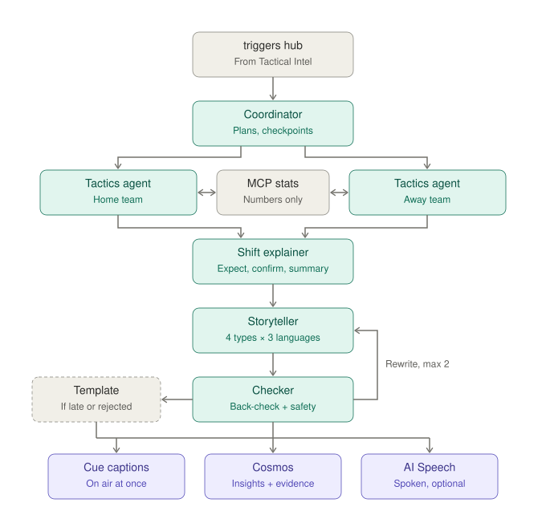

# OffBall: Low-Level Design · Insight Generation

**Status:** approved v1.0 · **Date:** 2026-10-23 · **Owner:** Lane 2
**Parent:** [High-level design](hld.md)

---

## 1. Scope

**Turning numbers into explanations.** Woken only by triggers from Tactical Intelligence, a team of agents looks up the numbers it needs and writes short, checked captions and recaps for every viewer type and language. **It never creates a number.** Our main entry for the Best Multi-Agent prize.



## 2. How it is triggered

```
Tactical Intelligence (trigger maker → trigger buffer)
        │ posts
        ▼
"triggers" hub (Event Hubs)
        │ listener
        ▼
Agent workflow service (Container App) → starts one workflow run per trigger → Coordinator
```

Tactical Intelligence decides **when** something is worth explaining. Insight Generation only decides **how to say it**.

Inside a run, agents fetch extra numbers by **tool calling**: the model asks for a tool by name, Agent Framework calls the MCP stats server, and the answer goes back to the model. The model never touches the database.

## 3. Functional requirements

| ID | Requirement | Priority |
|---|---|---|
| IG-1 | Start only when a trigger arrives (`crux`, `external`, `check_in`, `confirm_due`, `shift`, `summary`) | Must |
| IG-2 | Handle each trigger once, even if delivered twice | Must |
| IG-3 | Use the trigger's evidence pack as the starting point | Must |
| IG-4 | Agents get numbers only through the MCP stats server | Must |
| IG-5 | MCP tools for windows, line, pressing, style, formation, players, network, routes, normal style, period comparison, recent events | Must |
| IG-6 | Tools never return data after the given match time | Must |
| IG-7 | Coordinator plans the run, sets the deadline, collects results | Must |
| IG-8 | Two tactics agents (home, away) in parallel write findings | Must |
| IG-9 | Shift explainer writes one insight: expect, confirmed, retracted, check-in or summary | Must |
| IG-10 | Storyteller writes captions per viewer type and language from the insight only | Must |
| IG-11 | Checker verifies every number and claim; up to 2 rewrites | Must |
| IG-12 | Expect captions right after crux moments | Must |
| IG-13 | Confirm or retract at confirm-due time | Must |
| IG-14 | 15-minute check-ins | Must |
| IG-15 | Burst summaries for held triggers | Must |
| IG-16 | "Unusual for this manager" and "did it work?" when in the evidence | Must |
| IG-17 | Half-time and full-time recaps | Must |
| IG-18 | Player focus check-ins every 15 minutes | Should |
| IG-19 | Captions for a fixed set of viewer types × languages | Must |
| IG-20 | Viewer types: analyst, casual, club supporter, player focus | Must |
| IG-21 | Written directly in each language: English, Spanish, Hindi | Must |
| IG-22 | Every number must come from the evidence or an MCP call made for this trigger | Must |
| IG-23 | Non-English captions back-translated (Azure AI Translator) for checking | Must |
| IG-24 | Every caption passes Azure AI Content Safety | Must |
| IG-25 | Template caption on timeout or second rejection; `caption_source: template` | Must |
| IG-26 | Captions attached to the trigger's cue, on air immediately | Must |
| IG-27 | Store every insight with evidence and path (agent or template) | Must |
| IG-28 | Spoken captions (Azure AI Speech) | Should |
| IG-29 | Checkpoint after each agent step; resume after a crash | Must |
| IG-30 | Deadline: expect ≤ 8 s, others ≤ 20 s, recaps ≤ 60 s | Must |
| IG-31 | Run locally without Foundry using template agents | Must |
| IG-32 | Trace every agent and tool call (Foundry tracing) | Must |
| IG-33 | Measure checker pass rate and groundedness; post in CI | Must |
| IG-34 | **Ask the studio:** viewers ask a question, answered from MCP numbers up to their match minute, checked | Should |

## 4. Non-functional requirements

| Area | Target |
|---|---|
| Latency | Expect captions on air ≤ 8 s after the trigger |
| Grounding | 0 ungrounded numbers on air (checker + template fallback) |
| Checker pass rate | ≥ 90% on first or second try |
| Cost | ≤ 25 workflow runs per match (capped upstream); small model for live, larger for recaps and checking |
| Recovery | A killed run resumes from its last checkpoint within 10 s |

## 5. The agents

| Agent | Model | Tools allowed | Max tool calls | Output |
|---|---|---|---|---|
| Coordinator | Code + small model | none | – | Plan: which agents, deadline |
| Tactics agent (×2) | Small model | Team and player tools | 3 (live), 6 (recap) | Findings: what changed, size, vs. normal |
| Shift explainer | Small model | `compare_periods`, `get_normal_style` | 2 | One insight with evidence IDs |
| Storyteller | Small model | none | 0 | 12 captions |
| Checker | Code + larger model | `compare_periods`, any read tool | 3 | Pass, or rewrite request with reasons |
| Recap writer | Larger model | All read tools | 10 | Half-time / full-time recap |
| Q&A agent (Ask the studio) | Small model | All read tools | 4 | One answer |

All models are deployments in our Microsoft Foundry project.

### Which agents run per trigger

| Trigger | Agents |
|---|---|
| `crux` | Coordinator → both tactics agents → explainer (expect) → storyteller → checker |
| `confirm_due` | Coordinator → affected team's tactics agent → explainer (confirmed / retracted) → storyteller → checker |
| `shift`, `external` | Coordinator → affected team's tactics agent → explainer → storyteller → checker |
| `check_in` | Coordinator → both tactics agents → explainer (check-in) → storyteller → checker |
| `summary` | Coordinator → affected team's tactics agent → explainer (summary) → storyteller → checker |
| Half-time / full-time | Recap writer → storyteller → checker |

## 6. MCP stats server

A small Python MCP server (Container App) over the Stats API, which reads Cosmos (`metrics`, `windows`, `triggers`, `events`). Every tool takes an `as_of` match time and refuses data after it.

| Tool | Returns |
|---|---|
| `get_line_height(team, from, to)` | Line height, offside traps, window IDs |
| `get_pressing(team, from, to)` | Intensity, press size, triggers |
| `get_style(team, from, to)` | Style dial, tempo, rhythm |
| `get_formation(team, from, to)` | Shape in and out of possession |
| `compare_periods(team, a, b)` | All measures for both periods + differences |
| `get_normal_style(team)` | Baseline and normal ranges |
| `get_player_stats(player, from, to)` | Distance, sprints, passes, average position |
| `get_passing_network(team, from, to)` | Links and their danger |
| `get_chance_routes(team, from, to)` | Lanes and players involved |
| `get_recent_events(team, last_n)` | Latest goals, cards, subs |
| `get_match_state(as_of)` | Score, minute, cards, conditions |

Every response includes the window or event IDs it came from. The same server works with any MCP client (GitHub Copilot, VS Code, Claude Desktop).

## 7. Captions and personalization

Twelve captions per insight, keyed `{viewer_type}.{language}`:

| Viewer type | Style |
|---|---|
| `analyst` | Numbers and tactics, ≤ 30 words |
| `casual` | Plain words, one idea, ≤ 18 words |
| `supporter_home` / `supporter_away` | Same facts, framed from that club's side, ≤ 22 words |
Languages: `en`, `es`, `hi`. That makes 4 captions × 3 languages = 12 per insight.

**Player focus** viewers see the casual caption for team moments, plus their own player check-ins every 15 minutes (IG-18) and any caption where their player is named.

## 8. Checker rules

1. Extract every number and named measure from the caption.
2. Each must match a value in the evidence pack or a tool result from this run (rounding allowed: ±0.5 for metres, ±1 for percentages).
3. Non-English captions are translated back to English with Azure AI Translator and checked the same way.
4. Claims of change ("dropped", "pressing more") must agree with the sign of the difference.
5. Azure AI Content Safety must pass.
6. On failure: send reasons to the storyteller; at most 2 rewrites, then the template.

**Template example:** `"{team} line {before} m → {after} m since {minute}'"`, filled only from evidence.

## 9. Reliability

| Concern | Design |
|---|---|
| Duplicate triggers | Run ID = `trigger_id`; a second delivery finds the existing run and stops |
| Checkpoints | Agent Framework workflow checkpoints saved to Cosmos `checkpoints` after each step |
| Crash | Restart resumes unfinished runs from their last checkpoint |
| Deadline | Coordinator timer; when it fires, any missing captions use the template |
| Model quota or error | Template captions; banner in the producer console |

## 10. Ask the studio

```
Viewer question (+ their match minute) → Q&A agent → MCP tools (as_of = viewer's minute)
→ checker → answer in the viewer's language
```

Rate-limited per viewer. The answer cites the minutes and measures it used. Questions about the future ("who wins?") are answered with the current state only.

## 11. Outputs and storage

**Insight** (Cosmos `insights`, partition `match_id`)
```json
{
  "insight_id": "i-031",
  "trigger_id": "t-031",
  "match_id": "m001",
  "kind": "confirmed",
  "text_en_core": "NGU dropped 12 m deeper into a 4-4-1 after the red card and stopped pressing.",
  "captions": { "analyst.en": "…", "casual.es": "…", "supporter_away.hi": "…" },
  "evidence": { "event_ids": ["e-003101"], "window_ids": ["w-NGU-0600-1100", "w-NGU-0705-1205"] },
  "caption_source": "agent",
  "checker": { "attempts": 1, "passed": true },
  "latency_ms": 5200
}
```

The captions are attached to the trigger's cue as a new version (`status: on_air`) and pushed through Web PubSub. Spoken versions are generated on request per language.

## 12. Observability and evaluation

- Foundry tracing for every agent step and tool call, linked to Application Insights.
- Foundry evaluations (groundedness, relevance, fluency) on recorded runs of the three storylines.
- CI posts checker pass rate, template rate and groundedness on every pull request.

## 13. Code layout

```
insights/
  service.py            triggers listener, run starter
  workflow.py           Agent Framework graph and checkpoints
  agents/               coordinator.py, tactics.py, explainer.py, storyteller.py,
                        checker.py, recap.py, qa.py
  prompts/              one file per agent
  templates.py
  safety.py             Content Safety + Translator back-check
mcp_stats/
  server.py
  tools.py
  stats_api.py          Cosmos reads with as_of cut-off
```

## 14. Tests

| Test | Pass condition |
|---|---|
| Grounding | Injected wrong number in a caption is caught by the checker |
| Back-translation | A Spanish caption with a changed number fails |
| Template | Forced timeout produces a template caption, marked as such |
| Recovery | Kill the run after the tactics step; it resumes and finishes |
| Duplicate | Same trigger delivered twice produces one insight |
| Cut-off | Tools called with `as_of = 70:00` return nothing after 70:00 |
| End to end | Red-card storyline produces expect at ~70' and confirmed at ~74' |

## 15. Build order

| Day | Deliverable |
|---|---|
| Thu | Foundry project, model deployments; MCP stats server with 4 tools on the sample match |
| Fri | Workflow with coordinator, tactics agents, explainer, storyteller (EN); templates |
| Sat | Checker, Translator back-check, Content Safety, ES and HI; checkpoints and recovery |
| Sun | Recaps, Ask the studio, Speech, evaluations in CI |
