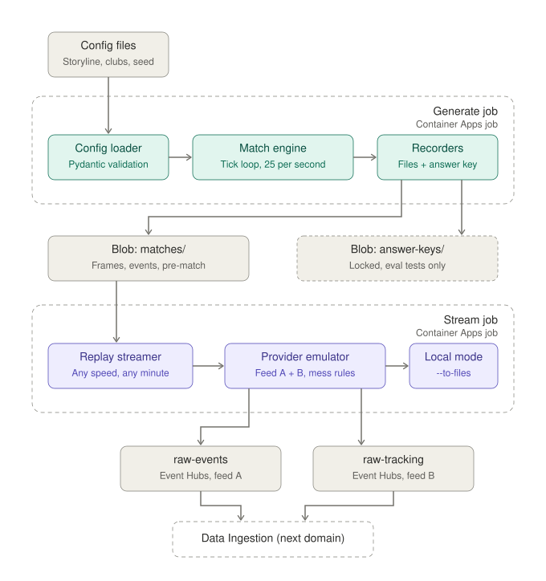
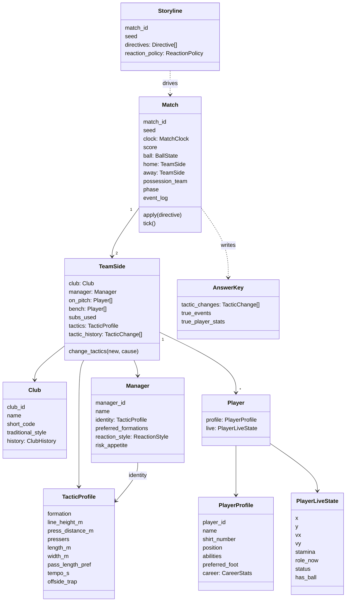
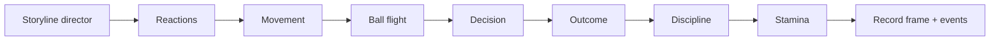

# OffBall: Low-Level Design · Match Simulation

**Status:** approved v1.0 · **Date:** 2026-10-21 · **Owner:** Lane 1
**Parent:** [High-level design](hld.md)

---

## 1. Scope and boundary

Match Simulation plays the outside world: the match itself and the two data companies that report on it. It is the only domain that knows what truly happened.

| Part | Job |
|---|---|
| Match engine | Plays the match tick by tick (ground truth) |
| Provider emulator | Turns the truth into two foreign, messy feeds |
| Replay streamer | Plays a generated match into Event Hubs at any speed |



The generate job creates the ground truth and writes it to storage. The stream job plays a stored match out as two foreign-format feeds. Both run from one Docker image as separate Container Apps jobs, so a demo can replay the same match any number of times.

**Sends out:** pre-match info and the two feeds, to Data Ingestion only.
**Never sends:** the answer key, abilities, stamina or live tactic settings. The answer key goes to a locked container read only by evaluation tests.

## 2. Vocabulary

| Term | Meaning |
|---|---|
| Tick | One simulation step, 40 ms (25 per second) |
| Frame | Ball and player positions at one tick |
| Manager identity | A manager's usual way of playing and reacting |
| Club history | Fictional past seasons: style, results, milestones |
| Tactic profile | A team's settings at a moment (line height, press, shape, pass length, tempo, formation, offside trap) |
| Slot | A player's home spot in the formation |
| Phase | In possession, out of possession, or transition (first 4 s after the ball changes hands) |
| Action | Pass, carry, shot, tackle, clearance |
| Storyline | Script of planned moments for one match |
| Directive | One storyline line: time + what happens |
| Reaction policy | Automatic tactic changes after events |
| Answer key | Hidden log of every tactic change and the true events |
| Seed | Number that makes a match repeatable |

## 3. Domain model



### 3.1 Tactics in three layers

```
Identity    (Manager.identity + Club.traditional_style)       public, rarely changes
   ↓  adjusted for opponent strength and available squad
Match plan  (TeamSide.tactics at kick-off)                    public as "expected setup"
   ↓  changed by directives and reaction policy
Live        (TeamSide.tactics during play)                    hidden, logged to answer key
```

The match plan is the identity plus small adjustments: against a stronger opponent, line height −3 m and pressers −1; with a key player missing, formation falls back to the manager's second choice.

### 3.2 Field definitions

**TacticProfile**

| Field | Type | Unit / range |
|---|---|---|
| formation | enum | `4-3-3`, `4-4-2`, `4-4-1`, `3-5-2` |
| line_height_m | float | 24–46 (back line distance from own goal) |
| press_distance_m | float | 6–16 (ball within this distance triggers a press) |
| pressers | int | 0–4 |
| length_m | float | 28–50 (back line to front line, out of possession) |
| width_m | float | 35–60 |
| pass_length_pref | float | 0 (short) to 1 (long) |
| tempo_s | float | 0.8–2.5 (average time on the ball) |
| offside_trap | bool | back line steps up together on opponent passes |

**PlayerProfile.abilities** (all 0–100): `pace`, `acceleration`, `passing`, `vision`, `finishing`, `dribbling`, `tackling`, `positioning`, `stamina`, `discipline`, `goalkeeping`.

**PlayerLiveState**

| Field | Type | Notes |
|---|---|---|
| x, y | float | metres, shared pitch coordinates |
| vx, vy | float | m/s |
| stamina | float | 0–1, starts at 1 |
| role_now | enum | `slot`, `carrier`, `presser`, `runner`, `receiver`, `cover`, `gk` |
| status | enum | `on`, `booked`, `sent_off`, `injured`, `subbed_off` |
| has_ball | bool | at most one true across both teams |

**Manager.reaction_style**

| Field | Example |
|---|---|
| on_red_card | `{ line_height_m: -12, formation: "4-4-1", pressers: 1, delay_s: 30 }` |
| on_lead_late | `{ from_minute: 60, line_height_m: -6, tempo_s: +0.4, delay_s: 300 }` |
| on_trailing_late | `{ from_minute: 70, line_height_m: +4, pressers: +1, sub_attacker: true }` |
| risk_appetite | 0–1; multiplies the size of every reaction |

**ClubHistory**: `seasons[]` with averages (line height, pressing, pass length, possession, formations used), `last_10[]` match summaries, `head_to_head{}`, `milestones_near[]`.

**CareerStats**: appearances, goals, assists, clean sheets (GK), `milestones_near[]` (e.g. "1 away from 50 goals").

### 3.3 Rules the Match enforces

| Rule | Check |
|---|---|
| Squad size | 11 per side at kick-off; match abandoned below 7 |
| Red card | Player status `sent_off`; cannot return or be replaced |
| Substitutions | At most 5 per team; subbed-off players cannot return |
| Ball | At most one `has_ball`; ball position equals carrier's position while carried |
| Clock | Strictly increasing; periods 1 and 2 with stoppage time |
| Goal | Score updates, possession to the conceding team, restart from centre |
| Tactic changes | Only through `TeamSide.change_tactics`, which always appends to `tactic_history` |

## 4. The tick loop



All per-player math in one tick is vectorized over the 23 objects with NumPy.

### 4.1 Storyline director
Applies every directive whose time has arrived. Forced events (goal, card, injury, sub) are injected at the next suitable moment: a forced goal starts a high-value chance for that team within 20 s rather than teleporting the ball.

### 4.2 Reactions
On events with a matching reaction rule, schedule a tactic change after `delay_s`, scaled by `risk_appetite`. Changes are applied through `change_tactics(new, cause)`.

### 4.3 Movement
**Target position for each player**

1. **Slot base.** Formation slot in team-relative units: `sx` (0 = own goal line of the block, 1 = front of the block), `sy` (0–1 across).
2. **Block placement.**
   - Out of possession: `x = line_height + sx * length + kx * (ball_x − 52.5)`, with `kx ≈ 0.25`, and the back line never below `line_height − 4`.
   - In possession: block stretches (`length × 1.4`, `width × 1.2`) and moves up with the ball.
   - `y = 34 + (sy − 0.5) * width + ky * (ball_y − 34)`, with `ky ≈ 0.35`.
3. **Roles override the slot.**
   - `carrier`: dribble target from the decision model.
   - `presser`: the nearest `pressers` defenders within `press_distance_m` of the ball run at the carrier.
   - `runner`: one or two attackers make runs into space behind the line when a forward pass is likely (these produce decoy runs).
   - `receiver`: moves to meet the pass.
   - `cover`: one defender holds behind the pressers.
   - `gk`: stays on the line between ball and goal centre, 0–12 m off the line.
4. **Offside trap.** If on, the back line steps up 2–4 m together when an opponent is about to pass forward.

**Steering**

```
max_speed  = (5.5 + 4.0 * pace / 100) * (0.85 + 0.15 * stamina)     # 5.5–9.5 m/s
max_accel  = 2.5 + 2.5 * acceleration / 100                         # 2.5–5.0 m/s²
desired_v  = unit(target − pos) * min(max_speed, |target − pos| / 0.6)
v          = v + clamp(desired_v − v, max_accel * dt)
pos        = pos + v * dt                                            # dt = 0.04 s
```

### 4.4 Ball flight
- Ground pass: speed 12–25 m/s (longer passes faster), slows by 1.2 m/s² of friction.
- Long ball (> 30 m, or pass_length_pref > 0.7): parabolic `z`, peak 3–8 m.
- Shot: 20–33 m/s scaled by finishing and distance.
- Reception when a player is within 1.0 m of the ball and the ball is below 1.5 m.

### 4.5 Decision (ball carrier)
The carrier decides after `tempo_s × U(0.6, 1.4)` seconds on the ball, or immediately when pressed within 2 m.

**Options:** pass to each teammate, carry forward (5–10 m), shoot (if within 30 m and the angle is reasonable).

```
openness(t)   = distance from teammate t to nearest opponent, capped at 10 m, scaled 0–1
progress(t)   = (t.x − carrier.x) / 30, clipped −1..1
length_fit(t) = 1 − |normalized_pass_length(t) − pass_length_pref|
lane_risk(t)  = opponents within 2 m of the passing lane
score_pass(t) = 1.2·openness + 1.0·progress + 0.6·length_fit − 0.8·lane_risk
score_shot    = 3.0·xG − 0.2
score_carry   = 0.4·space_ahead − 0.5·pressure
```

The choice is drawn from a softmax over scores with temperature `0.6 − 0.4 * vision / 100` (better vision picks the best option more often).

### 4.6 Outcome

```
p_pass  = sigmoid(2.2 − 0.045·distance − 0.9·lane_risk − 0.8·pressure + 1.5·(passing/100 − 0.5))
xG      = sigmoid(−0.9 − 0.11·distance_to_goal − 1.2·|angle_off_centre| − 0.6·defenders_in_cone)
p_goal  = xG · (0.8 + 0.4·finishing/100) · (1.1 − 0.3·gk_goalkeeping/100)
p_tackle_win = sigmoid(0.5·(tackling − dribbling)/20 − 0.3)
```

- Failed pass: the nearest opponent to the lane wins the ball (interception) or the ball goes out.
- Offside: checked at the moment of a forward pass; the receiver is beyond the second-last defender and the ball → offside event, free kick to the defending team.

Coefficients are starting values and are tuned until the realism tests pass (section 10).

### 4.7 Discipline
- Each tackle attempt: `p_foul = 0.12 + 0.15·(1 − discipline/100) + 0.1·(from_behind)`.
- Each foul: `p_yellow = 0.12 + 0.2·(1 − discipline/100)`; a second yellow means a red; `p_straight_red = 0.01`.
- Fouls in the box become penalties, taken as a shot with xG 0.76.

### 4.8 Stamina
```
drain   = 0.00002 · max(0, speed − 4.0)²  per tick
recover = 0.000004 per tick when speed < 2.0
stamina = clip(stamina − drain + recover, 0.3, 1.0)
```
Players with low stamina are preferred for substitution by the manager's sub logic (from 60', at most 3 windows).

### 4.9 Set pieces (simplified)
Throw-ins, corners, goal kicks and free kicks restart from the correct spot with players moved to simple template positions over 3–6 s of game time. Corners create a header chance with xG 0.03–0.08.

## 5. Provider emulator

Two writers turn true frames and events into foreign formats. Each mess rule can be switched on or off in config (`mess: off | light | full`). The exact mess list is designed separately; candidates are listed here.

| | Feed A (event style, "Opta-like") | Feed B (tracking style, "TRACAB-like") |
|---|---|---|
| Content | Events + lineups + pre-match info | Frames |
| Coordinates | 0–100 grid on both axes, attacking direction flips at half-time | Centimetres, origin at pitch centre |
| Clock | Seconds since period start, offset by a random 0.5–2.0 s | Frame counter from its own start, 25 Hz |
| Field names | `typeId`, `outcome`, `x`, `y`, `qualifiers[]` | `frameIdx`, `ball[]`, `home[]`, `away[]` |
| IDs | Its own numeric player IDs + lookup in lineups | Shirt numbers only |

**Mess candidates:** duplicate messages, dropped frames, out-of-order delivery, late corrections (same event re-sent with new type or position), deletions, clock drift, unit mistakes in a small share of records.

## 6. Replay streamer

| Concern | Design |
|---|---|
| Input | Generated files in Blob `matches/{match_id}/` |
| Scheduling | Loop on match time; sleep until `start_wall + (clock_ms − from_ms) / speed` |
| Batching | Feed B: 5 frames per message (every 200 ms of match time). Feed A: one message per event |
| Ordering | Partition key `match_id`; send in match-time order unless the "out of order" mess rule is on |
| Headers | `emitted_at` (UTC, ms), `feed` (`A`/`B`), `match_id` |
| Start point | `--from mm:ss` skips ahead; pre-match info is always sent first |
| Speed | 1×–60×; drift is measured each second and corrected |
| Failure | SDK retries with backoff; on exit, logs last sent `clock_ms` so a restart can resume with `--from` |
| Client | `azure-eventhub` async producer with `DefaultAzureCredential` |

## 7. Output schemas

**`match.json`**
```json
{
  "schema_version": "0.1",
  "match_id": "m001",
  "seed": 42,
  "storyline": "red_card",
  "home": { "club_id": "RIV", "manager_id": "MGR-RIV", "lineup": ["RIV-01", "…"], "bench": ["…"] },
  "away": { "club_id": "NGU", "manager_id": "MGR-NGU", "lineup": ["…"], "bench": ["…"] },
  "pitch": { "length_m": 105, "width_m": 68 },
  "kickoff_team": "RIV"
}
```

**`frames.parquet`** columns: `frame` (int32), `match_clock_ms` (int64), `period` (int8), `ball_x`, `ball_y`, `ball_z` (float32), then per player slot `p{1..22}_id` (category), `p{1..22}_x`, `p{1..22}_y` (float32, null when off the pitch). Compressed with zstd.

**`events.jsonl`**: one clean event per line in the shared event schema (HLD section 6), plus truth-only fields `true_xg` and `true_pressure` used only by evaluation.

**`answer_key.json`**
```json
{
  "match_id": "m001",
  "tactic_changes": [
    {
      "at_clock_ms": 4235000,
      "team_id": "NGU",
      "cause": { "type": "reaction", "trigger_event_id": "e-003101", "rule": "on_red_card" },
      "before": { "line_height_m": 38, "formation": "4-4-2", "pressers": 2 },
      "after": { "line_height_m": 26, "formation": "4-4-1", "pressers": 1 }
    }
  ],
  "true_player_stats": { "RIV-07": { "distance_m": 10840, "top_speed_ms": 9.1, "sprints": 31 } }
}
```

**`prematch.json`** (public, sent through feed A): clubs with traditional style and history summaries, managers with identity and preferred formations, team sheets, player profiles **without abilities** (name, number, position, career, milestones near).

## 8. Config schemas

**Storyline** (`storylines/red_card.yaml`)
```yaml
match_id: m001
seed: 42
home: RIV
away: NGU
directives:
  - { at: "23:10", force: goal, team: RIV }
  - { at: "46:00", set_tactics: { team: NGU, formation: "3-5-2", pressers: 3 } }
  - { at: "70:05", force: red_card, player: NGU-04 }
  - { at: "77:30", force: goal, team: NGU }
```
Reactions come from each manager's `reaction_style` unless a storyline overrides them.

**Club + manager + squad** (`clubs/RIV.yaml`)
```yaml
club_id: RIV
name: Riverside Athletic
traditional_style: "Patient possession side for a decade"
manager:
  manager_id: MGR-RIV
  name: Elena Marsh
  identity: { formation: "4-3-3", line_height_m: 42, press_distance_m: 12, pressers: 3, length_m: 34, width_m: 52, pass_length_pref: 0.25, tempo_s: 1.0, offside_trap: true }
  preferred_formations: ["4-3-3", "4-2-3-1"]
  reaction_style:
    on_red_card: { line_height_m: -12, formation: "4-4-1", pressers: 1, delay_s: 30 }
    on_lead_late: { from_minute: 60, line_height_m: -6, tempo_s: 0.4, delay_s: 300 }
  risk_appetite: 0.6
squad:
  - { player_id: RIV-07, name: Tom Reyes, number: 7, position: RW, foot: L,
      abilities: { pace: 88, acceleration: 85, passing: 74, vision: 70, finishing: 70, dribbling: 82, tackling: 35, positioning: 68, stamina: 80, discipline: 60 } }
history_seed: 7
```
Club history is generated from the manager identity plus noise using `history_seed`, so it is consistent with how the team plays.

All config files are validated with Pydantic at load; any error stops the job with the file, field and reason.

## 9. Code layout and key interfaces

```
sim/
  domain/        match.py, team_side.py, club.py, manager.py, player.py,
                 tactic_profile.py, formation.py, clock.py, events.py, rules.py
  models/        movement.py, ball.py, decision.py, outcome.py,
                 discipline.py, stamina.py, reaction.py, set_pieces.py
  storyline/     director.py, loader.py, storylines/*.yaml
  clubs/         *.yaml, history.py
  providers/     feed_a.py, feed_b.py, mess.py
  output/        frames_writer.py, events_writer.py, answer_key.py, prematch.py
  stream/        streamer.py
  cli.py
  tests/
```

```python
def generate_match(storyline: Storyline, clubs: dict[str, ClubConfig], out_dir: Path) -> MatchFiles: ...

class Match:
    def tick(self) -> TickResult: ...
    def apply(self, directive: Directive) -> None: ...

class TeamSide:
    def change_tactics(self, new: TacticProfile, cause: Cause, at_clock_ms: int) -> None: ...

class MovementModel:
    def targets(self, match: Match) -> np.ndarray: ...
    def step(self, positions: np.ndarray, velocities: np.ndarray, targets: np.ndarray, limits: np.ndarray) -> tuple[np.ndarray, np.ndarray]: ...

class DecisionModel:
    def choose(self, match: Match, carrier: Player, rng: np.random.Generator) -> Action: ...

class OutcomeModel:
    def resolve(self, match: Match, action: Action, rng: np.random.Generator) -> list[MatchEvent]: ...

class ProviderWriter(Protocol):
    def prematch(self, info: PrematchInfo) -> list[dict]: ...
    def frames(self, batch: FrameBatch) -> dict: ...
    def event(self, event: MatchEvent) -> list[dict]: ...

async def stream_match(match_id: str, speed: float, from_ms: int, mess: MessLevel) -> None: ...
```

**Command line**
```
python -m sim generate --storyline red_card --out ./out
python -m sim stream --match m001 --speed 10 --from 65:00 --mess light
python -m sim stream --match m001 --to-files ./local_feeds
```
`--to-files` writes the feeds locally instead of Event Hubs, so other lanes can work without Azure.

## 10. Testing

| Test | Pass condition |
|---|---|
| Repeatability | Output file hashes for seed 42 match the stored hash |
| Realism | Pass accuracy 75–88%; 350–600 passes per team; 8–18 shots per team; 9–12 km per outfield player; top speed ≤ 10 m/s; 0–5 goals; possession split between 35/65 and 65/35 |
| Match rules | Never more than 11 on the pitch; red-carded players never return; ≤ 5 subs; one ball carrier |
| Detectability | For each tactic change: measured back-line height moves ≥ 6 m, or pressers per press changes ≥ 30%, within 2 minutes |
| Manager identity | Over 3 seeds, a high-press manager's team presses more than a low-block manager's team |
| No leaks | No feed message contains tactic settings, abilities or stamina |
| Speed | Full match generated in ≤ 60 s on the CI runner |
| Config errors | Broken storyline or club file fails with a clear message |
| Streamer | At 10× for 60 s of match time, drift ≤ 50 ms |

## 11. Deployment

| Piece | Azure |
|---|---|
| Image | One Docker image `offball-sim` (Python 3.12 slim) |
| Generate | Container Apps job, manual trigger, 1 vCPU / 2 GB |
| Stream | Container Apps job, manual trigger, 0.5 vCPU / 1 GB |
| Storage | Blob `matches/` and `answer-keys/` |
| Identity | User-assigned managed identity `id-sim`: Event Hubs Data Sender on `raw-events` and `raw-tracking`; Storage Blob Data Contributor on `matches/` and `answer-keys/` |
| Answer-key access | Only `id-eval` has Storage Blob Data Reader on `answer-keys/` |
| Monitoring | Azure Monitor OpenTelemetry Distro → Application Insights |

## 12. Errors and failure handling

| Situation | Behaviour |
|---|---|
| Invalid config | Job exits non-zero with file, field, reason |
| Realism check fails after generation | File still written; warning logged with the failing metrics |
| Forced event cannot happen (e.g. red card for a player already off) | Job fails with the directive and reason |
| Event Hubs throttling | SDK retry with backoff; drift corrected after recovery |
| Stream job killed | Restart with `--from` the last logged clock |

## 13. Performance plan

- 135,000 ticks × vectorized updates for 23 objects; target ≤ 0.4 ms per tick (≈ 55 s per match).
- Decision and outcome run only when the carrier decides (about 1,500 times per match), not every tick.
- Frames are buffered in NumPy arrays and written to Parquet once at the end.
- Profile with `cProfile` once the first full match runs; optimize the top three hot spots only.

## 14. Build order

| Day | Deliverable |
|---|---|
| Wed | Crude sample match: players hold formation and shift with the ball, simple passing. Files committed for Lanes 2 and 3 |
| Thu | Possession, passing, line height, pressing; realism tests running |
| Fri | Shots, goals, fouls, cards, subs, reactions; manager identity; answer key |
| Sat | Offside trap, set pieces, three storylines, provider feeds A and B, streamer on Azure |
| Sun | Mess rules switchable; detectability and leak tests green |

## 15. Open items

- Final mess list for each feed (next design session).
- Names and squads for the three fictional clubs.
- Whether a fourth formation (`4-2-3-1`) is needed for any storyline.
