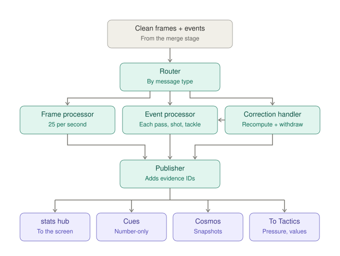

# OffBall: Low-Level Design · Performance Metrics

**Status:** approved v1.0 · **Date:** 2026-10-22 · **Owner:** Lane 1
**Parent:** [High-level design](hld.md)

---

## 1. Scope

Numbers about **individual players, the ball and single actions**. Anything about a team over time (line height, pressing as a tactic, formation) belongs to Tactical Intelligence.

Pressure on one player at one moment lives here. Pressing as a team tactic lives in Tactical Intelligence.



## 2. Functional requirements

| ID | Requirement | Priority |
|---|---|---|
| PM-1 | Name tag for every player, following their position | Must |
| PM-2 | Speed of every player, smoothed | Must |
| PM-3 | Distance covered per player | Must |
| PM-4 | Sprints: count and top speed per player | Must |
| PM-5 | Alerts: sprint over 32 km/h, new match top speed, 10 km covered | Must |
| PM-6 | Ball speed at all times | Must |
| PM-7 | Shot speed for every shot | Must |
| PM-8 | Pass speed for every pass | Must |
| PM-9 | Pass distance for every pass | Must |
| PM-10 | Pass accuracy per player and team | Must |
| PM-11 | Pass difficulty 0–100 for every pass | Must |
| PM-12 | Completion vs. expected per player | Should |
| PM-13 | xG for every shot, **taken from the provider (feed A)** | Must |
| PM-14 | xG shown as a range with the chance story | Must |
| PM-15 | Big-chance flag (xG ≥ 0.3) | Must |
| PM-16 | Open options at each pass | Must |
| PM-17 | Decision score: option chosen vs. best available | Must |
| PM-18 | Decoy run credit | Must |
| PM-19 | Pressure seconds | Should |
| PM-20 | Fatigue drop-off | Nice |
| PM-21 | Send each update on the `stats` hub | Must |
| PM-22 | Create number-only cues; they go **on air automatically** | Must |
| PM-23 | Every number carries evidence (event IDs, frames) | Must |
| PM-24 | Save snapshots for agents (via MCP), recaps and replays | Must |
| PM-25 | Recompute and update or withdraw cues when an event is corrected or deleted | Must |
| PM-26 | Hand pressure and pass values to Tactical Intelligence | Must |
| PM-27 | After a match, compare distance, top speed and sprints with the simulator's truth | Should |
| PM-28 | Run locally without Azure | Must |
| PM-29 | Player heatmap: share of time in each cell of a 21 × 14 grid (5 m cells), per player, updated every 10 s of match time | Should |

## 3. Non-functional requirements

| Area | Target |
|---|---|
| Delay | Frame results ≤ 20 ms; event results ≤ 50 ms after the event arrives |
| Accuracy vs. truth | Distance within 3%, top speed within 0.3 m/s, sprint count within 2 |
| Memory | ≤ 300 MB per match (last 10 s of frames + running totals) |
| Restart | Running totals rebuilt from Cosmos snapshots + replay from checkpoint |

## 4. How it is triggered and who uses the results

Nothing polls. The merge stage hands every clean message to the **router** by direct function call (see [Data Ingestion §9](lld-data-ingestion.md#9-triggering)):

| Message | Goes to |
|---|---|
| Frame batch | Frame processor |
| Event | Event processor |
| `event.upsert` / `event.delete` | Correction handler, which re-runs the event processor or removes results |

The **publisher** attaches evidence and sends every result four ways:

| Destination | Who uses it |
|---|---|
| `stats` hub | **The UI** (via the PubSub bridge and Web PubSub) and the Fabric dashboard |
| Cues | Broadcast; number-only cues are created with `status: on_air` |
| Cosmos `metrics` | Stats API → MCP → agents; recaps; replays |
| Direct call | Tactical Intelligence (pressure, pass values) |

**Example, one pass at 12:10:** the pass event arrives → frames at 12:10.000 read from memory → distance 24.1 m, speed 18 m/s, 3 open options, decision score 0.82, difficulty 71, RIV-09 pulled 2 defenders (decoy credit) → pass arc cue + stats + snapshot. If a correction later says it was intercepted, accuracy is recomputed and the cue is withdrawn.

## 5. Calculations

All positions in metres, time step 0.04 s.

### 5.1 Movement (frame processor)
- **Smoothing:** centred moving average over 5 frames (0.2 s) of each player's and the ball's position.
- **Speed:** distance between smoothed positions 0.2 s apart ÷ 0.2.
- **Distance:** sum of smoothed displacement per frame; steps below 0.1 m/s are ignored as jitter.
- **Sprint:** speed ≥ 7.0 m/s (25.2 km/h) held for ≥ 1 s. Top speed is the highest speed held for ≥ 0.4 s.
- **Alerts:** speed ≥ 8.9 m/s (32 km/h); new match top speed after 10:00; distance crosses 10 km.
- **Ball speed:** same smoothing on the ball. **Shot speed** and **pass speed** = peak ball speed in the 0.3 s after the event.

### 5.2 Pressure
```
d        = distance from the player to the nearest opponent
pressure = clip((5 − d) / 4, 0, 1)          # 1 at ≤ 1 m, 0 at ≥ 5 m
```

### 5.3 Pitch value
A simple value for any spot, used to compare options:
```
dist   = distance to the centre of the opponent's goal
angle  = angle between the goalposts seen from the spot
V(x,y) = clip(exp(−dist / 18) · (0.4 + 0.6 · angle / 1.2), 0, 1)
```

### 5.4 Pass quality (event processor)
```
lane_opp      = opponents within 1.5 m of the line from passer to target
p_complete    = sigmoid(2.2 − 0.045·distance − 0.9·lane_opp − 0.8·pressure(passer) − 0.6·pressure(receiver))
difficulty    = round(100 · (1 − p_complete))
```
- **Accuracy:** completed ÷ attempted, running per player and team.
- **Completion vs. expected:** completed − Σ `p_complete`, per player.

### 5.5 Open options and decision score
- A teammate is an **open option** when: nearest opponent ≥ 4 m, `lane_opp = 0`, and distance from the passer ≤ 40 m.
- **Option value** = `V(teammate position) · p_complete(option)`.
- **Decision score** = value of the option chosen ÷ highest option value (0–1). The best option is stored, so the UI can draw a ghost arrow to it.

### 5.6 Decoy run credit
For each completed pass, look at the 3 s before it. A teammate (not passer or receiver) earns credit when:
1. they ran at ≥ 4 m/s,
2. at least one opponent who started within 8 m of the receiver closed ≥ 2 m toward that runner, and
3. the receiver's distance to the nearest opponent grew by ≥ 2 m.

Credit = number of opponents pulled. Shown as the runner's path and the defenders being dragged.

### 5.7 Pressure seconds
Time from receiving the ball until `pressure ≥ 0.75` (an opponent within 2 m), compared with the player's average this match.

### 5.8 xG range and chance story
- Each shot's xG comes from feed A (`provider_xg`).
- **Match range:** goals from all shots modelled as independent chances; the 10th–90th percentile of the total goals is the range (exact calculation by dynamic programming over the shots).
- **Chance story:** count of big chances (xG ≥ 0.3) and how much of the total xG they make up. Example: "1–3 goals expected, mostly from 2 big chances."

### 5.9 Player heatmap
Count frames each player spends in each 5 m × 4.86 m cell (21 × 14 grid), for the whole match and the last 15 minutes. Sent as normalized shares every 10 s (`kind: heatmap`) and stored with the 10-second totals.

### 5.10 Fatigue drop-off (nice to have)
Highest sprint speed in the last 5 minutes ÷ highest in the first 15 minutes, per player.

## 6. Outputs

**Stats message** (on `stats`)
```json
{
  "kind": "pass",
  "match_id": "m001",
  "match_clock_ms": 730120,
  "player_id": "RIV-07",
  "values": { "distance_m": 24.1, "speed_ms": 18.0, "difficulty": 71, "open_options": 3, "decision_score": 0.82, "decoy_credit": { "RIV-09": 2 } },
  "best_option": { "player_id": "RIV-11", "x": 80.2, "y": 12.5 },
  "evidence": { "event_ids": ["e-004512"], "frames": [18253] }
}
```

**Number-only cue kinds:** `name_tags` (continuous), `speed_alert`, `distance_milestone`, `pass_arc`, `shot_speed`, `xg_summary`, `decoy_run`, `best_option`. All use the shared cue schema with `status: on_air` and `caption_source: none`.

## 7. Storage

| Data | Store | Key |
|---|---|---|
| Per-player totals every 10 s of match time | Cosmos `metrics` | partition `match_id`, id `player:{id}:{clock}` |
| Per-pass and per-shot results | Cosmos `metrics` | partition `match_id`, id `event:{event_id}:{version}` |
| Rolling frame memory (last 10 s) | In memory only | – |

## 8. Code layout

```
engine/metrics/
  router.py
  frame_processor.py      smoothing, speed, distance, sprints, alerts, name tags
  event_processor.py      pass quality, shots, open options, decision, decoy, pressure seconds
  correction_handler.py
  calc/                   pressure.py, pitch_value.py, pass_model.py, xg_range.py, decoy.py
  publisher.py
  tests/
```

## 9. Tests

| Test | Pass condition |
|---|---|
| Truth comparison | Distance ±3%, top speed ±0.3 m/s, sprints ±2 vs. answer key |
| Difficulty sanity | Completion rate falls as difficulty band rises |
| Open options | Hand-built scenes return the expected count and best option |
| Decoy credit | Hand-built decoy run earns credit; a standing teammate does not |
| xG range | Known shot sets give the expected percentiles |
| Corrections | A pass corrected to intercepted withdraws its cue and lowers accuracy |
| Delay | Frame ≤ 20 ms, event ≤ 50 ms on the CI runner |

## 10. Build order

| Day | Deliverable |
|---|---|
| Thu | Speed, distance, name tags, ball speed on the sample match (Lane 3 gets moving tags) |
| Fri | Sprints, alerts, pass distance/accuracy/difficulty, shot speed, provider xG and range |
| Sat | Open options, decision score, decoy credit, corrections, Cosmos snapshots |
| Sun | Pressure seconds, truth comparison in CI; fatigue if time allows |
