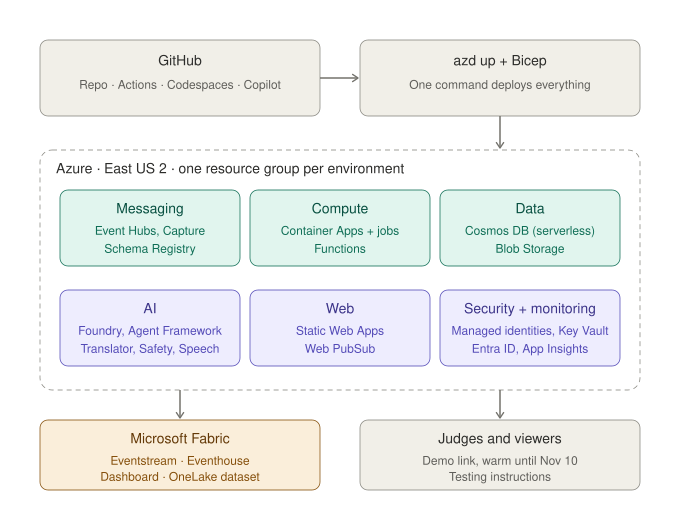

# OffBall: Low-Level Design · Platform

**Status:** approved v1.0 · **Date:** 2026-10-23 · **Owner:** Lane 2
**Parent:** [High-level design](hld.md)

---

## 1. Scope

Everything that makes the other seven domains run, stay safe and be provable: Azure setup, security, monitoring, the Fabric dashboard, the open dataset, CI/CD, the developer setup, and keeping the demo alive for judges.



## 2. Decisions

| Decision | Choice |
|---|---|
| Region | **East US 2** |
| Judge visits | **One instance kept warm through Nov 10, 2026**, then scale to zero |
| Azure subscription and budget | **Open:** to be decided by the team |
| Fabric capacity | **Open:** to be confirmed. Fallback: Application Insights workbook for the dashboard, Blob Storage only for the dataset |

## 3. Functional requirements

| ID | Requirement | Priority |
|---|---|---|
| PL-1 | `azd up` deploys everything from Bicep | Must |
| PL-2 | One environment per developer + `demo` | Must |
| PL-3 | One region, one resource group per environment | Must |
| PL-4 | Event Hubs: `raw-events`, `raw-tracking`, `normalized`, `stats`, `triggers`; Capture on raw hubs; Schema Registry | Must |
| PL-5 | Cosmos DB serverless: `events`, `metrics`, `windows`, `triggers`, `insights`, `cues`, `checkpoints` | Must |
| PL-6 | Container Apps: match engine, stats API + MCP server, agent workflow, cue manager; jobs: generate, stream | Must |
| PL-7 | Functions: normalizers A and B, PubSub bridge | Must |
| PL-8 | Web PubSub, Static Web Apps, Blob Storage, Foundry project, Translator, Content Safety, Speech | Must |
| PL-9 | Managed identity per service, least privilege | Must |
| PL-10 | Answer keys readable only by the evaluation identity | Must |
| PL-11 | No secrets in code; Key Vault for anything unavoidable | Must |
| PL-12 | Producer console behind Entra ID; demo account for judges | Must |
| PL-13 | Rate limits on model-calling public endpoints | Must |
| PL-14 | Secret scanning on the public repo | Should |
| PL-15 | OpenTelemetry in every service → Application Insights | Must |
| PL-16 | Foundry tracing linked to the same traces | Must |
| PL-17 | Delay measured at every step | Must |
| PL-18 | Fabric Real-Time Dashboard | Must |
| PL-19 | Alerts on errors, dead-letter spikes, model failures | Should |
| PL-20 | Open synthetic dataset in OneLake and a GitHub Release | Must |
| PL-21 | Cosmos DB mirrored into Fabric | Should |
| PL-22 | CI on every push: lint, unit, realism, Playwright | Must |
| PL-23 | Results comment on every pull request | Must |
| PL-24 | Merge to `main` deploys `demo` | Should |
| PL-25 | VERSION.md check in CI | Should |
| PL-26 | Codespaces dev container | Must |
| PL-27 | Local mode: files instead of Azure, template agents instead of models | Must |
| PL-28 | README section on GitHub Copilot and Azure MCP Server use | Must |
| PL-29 | Recorded runs of the three storylines | Must |
| PL-30 | "Run live" button through the full Azure pipeline, rate-limited | Must |
| PL-31 | Up and free to test through Nov 10; budget alert | Must |
| PL-32 | Warm instances so judges never hit a cold start | Must |
| PL-33 | Testing instructions: links, demo login, what to click | Must |

## 4. Resources

| Resource | Name pattern | Notes |
|---|---|---|
| Resource group | `rg-offball-{env}` | East US 2 |
| Event Hubs | `evh-offball-{env}` | Standard, 1 throughput unit, Capture to OneLake (or Blob), Schema Registry group `offball` |
| Cosmos DB | `cos-offball-{env}` | NoSQL, serverless; database `offball` |
| Storage | `stoffball{env}` | Containers: `matches`, `answer-keys`, `dead-letter`, `snapshots` |
| Container Apps environment | `cae-offball-{env}` | Apps: `engine`, `stats-mcp`, `insights`, `cues`; jobs: `sim-generate`, `sim-stream` |
| Function app | `func-offball-{env}` | Flex Consumption: `normalize-a`, `normalize-b`, `pubsub-bridge` |
| Web PubSub | `wps-offball-{env}` | Hub `match` |
| Static Web App | `swa-offball-{env}` | Viewer screen + producer console |
| Foundry | `aif-offball-{env}` | Small and large model deployments; tracing to App Insights |
| AI Services | `ais-offball-{env}` | Translator, Content Safety, Speech |
| Key Vault | `kv-offball-{env}` | Only if a secret is unavoidable |
| Monitoring | `appi-offball-{env}`, `log-offball-{env}` | Application Insights + Log Analytics |
| Container registry | `croffball{env}` | Images built by `azd` |
| Fabric | workspace `offball` | Eventstream, Eventhouse, Real-Time Dashboard, Lakehouse |

## 5. Identities and access

| Identity | Can do |
|---|---|
| `id-sim` | Send to `raw-events`, `raw-tracking`; write `matches`, `answer-keys` |
| `id-ingest` | Receive raw hubs; send `normalized`; write `dead-letter` |
| `id-engine` | Receive `normalized`; send `stats`, `triggers`; read/write `events`, `metrics`, `windows`, `triggers`; write frames to OneLake; write `snapshots` |
| `id-stats-mcp` | Read `events`, `metrics`, `windows`, `triggers` |
| `id-insights` | Receive `triggers`; call Foundry, Translator, Content Safety, Speech; read/write `insights`, `checkpoints`; call the cue manager |
| `id-cues` | Read/write `cues`; publish to Web PubSub |
| `id-bridge` | Receive `stats`; publish to Web PubSub |
| `id-eval` | **Only identity** that reads `answer-keys`; read `events`, `windows`, `triggers` |
| GitHub Actions (federated) | Deploy with `azd`; run evaluation jobs as `id-eval` |

## 6. Monitoring

- Every service uses the Azure Monitor OpenTelemetry Distro; each message keeps `emitted_at` and each step adds its own timestamp.
- Foundry tracing writes agent steps and tool calls into the same Application Insights.
- **Fabric Real-Time Dashboard** (Eventstream reads `stats` and `triggers`; Eventhouse stores them):

| Tile | Shows |
|---|---|
| Delay per step | Simulator → ingest → engine → screen, per cue kind |
| Ingestion | Duplicates, corrections, deletions, rejects, gaps, clock offset |
| Tactics | Line height, pressing, control over time; triggers sent vs. held |
| Agents | Runs, latency, checker pass rate, template rate |

- Alerts: 5xx errors, dead-letter rate above 1%, model failures, budget at 80%.

## 7. Data products

- **Open dataset:** the three storyline matches (frames Parquet, events JSONL, answer keys, pre-match) written to the Fabric Lakehouse and attached to a GitHub Release with a short data card.
- **Mirroring:** Cosmos DB mirrored into Fabric for post-match queries (Should).

## 8. CI/CD

| Workflow | Trigger | Steps |
|---|---|---|
| `ci.yml` | Every push and pull request | Lint (ruff, eslint), unit tests, simulation realism tests, ingestion recovery test, detection scoring, Playwright, VERSION.md check |
| `results.yml` | Pull request | Runs the three storylines in local mode; posts recovery %, detection score, checker pass rate and delay as a comment with GitHub CLI |
| `deploy.yml` | Merge to `main` | `azd deploy` to `demo` with federated credentials |
| `eval.yml` | Manual | Foundry evaluations (groundedness, relevance, fluency) on recorded runs |

## 9. Developer setup

- **Codespaces dev container:** Python 3.12, Node 20, Azure CLI, azd, Functions Core Tools, GitHub CLI, Playwright browsers.
- **Local mode:** `make local` runs generate → stream to files → ingest → engine → template agents → cue manager → web app, with no Azure account.
- **Copilot:** Agent Mode and the Azure MCP Server configured in `.vscode/mcp.json`; how we used them goes in the README.

## 10. Demo and judging

| Item | Design |
|---|---|
| Recorded runs | Each storyline's full output (cues, captions, insights) stored; the viewer plays them with no model calls |
| Run live | Button starts generate → stream → full pipeline on Azure; one live run at a time, 5 per hour |
| Warm | `minReplicas: 1` on viewer-facing apps and the engine through Nov 10; Functions keep one always-ready instance |
| Budget | Subscription budget with alerts at 50%, 80%, 100% |
| Testing instructions | Viewer link, producer console link + demo login, three things to try, local-mode command |

## 11. Repository layout

```
infra/          main.bicep, modules/*.bicep, azure.yaml
sim/            Match Simulation
ingest/         normalizers (Functions)
engine/         merge stage, metrics, tactics
mcp_stats/      MCP server + stats API
insights/       agent workflow
broadcast/      cue manager, PubSub bridge
web/            viewer screen + producer console
contracts/      JSON Schemas
fabric/         Eventhouse tables, dashboard definition
.devcontainer/  Codespaces
.github/        workflows
docs/design/    HLD and LLDs
```

## 12. Build order

| Day | Deliverable |
|---|---|
| Thu | Repo skeleton, dev container, `azd` with Event Hubs, Cosmos, Storage, Container Apps environment; CI lint + tests |
| Fri | Functions, Web PubSub, Static Web Apps, Foundry, AI Services; identities and access |
| Sat | First end-to-end run on Azure; Fabric Eventstream + dashboard (or fallback); results comment |
| Sun | Warm settings, budget alerts, recorded runs, run-live limits, deploy on merge |
| Mon | Dataset release, testing instructions |
