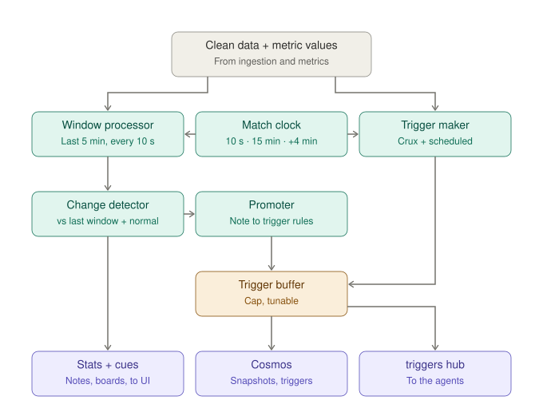

# OffBall: Low-Level Design · Tactical Intelligence

**Status:** approved v1.0 · **Date:** 2026-10-22 · **Owner:** Lane 1
**Parent:** [High-level design](hld.md)

---

## 1. Scope

**How each team plays over time, and when that changes.** This is our core domain. It reads clean data from Data Ingestion plus per-moment values from Performance Metrics (pressure, pass values), and produces team tactics, detected changes, and the **triggers** that wake the AI agents. It is the only domain that decides what is worth explaining.



## 2. Functional requirements

| ID | Requirement | Priority |
|---|---|---|
| TI-1 | Every 10 s of match time, recompute each team's tactics over a rolling 5-minute window | Must |
| TI-2 | Keep window history so any two periods can be compared | Must |
| TI-3 | Defensive line height | Must |
| TI-4 | Offside trap: back line stepping up together; offsides won | Must |
| TI-5 | Compactness: team length and width out of possession | Should |
| TI-6 | Formation in and out of possession | Should |
| TI-7 | Overloads | Nice |
| TI-8 | Pressing intensity | Must |
| TI-9 | Press size | Must |
| TI-10 | Press triggers | Must |
| TI-11 | Ball recovery time | Should |
| TI-12 | Style dial: short and patient ↔ long and direct | Must |
| TI-13 | Control vs. chaos | Must |
| TI-14 | Game rhythm | Should |
| TI-15 | Passing network per window | Must |
| TI-16 | Chance routes by side and player | Must |
| TI-17 | Line-breaking passes | Should |
| TI-18 | Each team's normal style from pre-match info | Must |
| TI-19 | Flag play that is unusual for the team or manager | Must |
| TI-20 | Detect changes: team line, pressing, style, formation, and **individual player position** | Must |
| TI-20b | Two levels: **tactical notes** (every change, no AI) and **tactical triggers** (important changes, wake agents) | Must |
| TI-21 | 15-minute check-ins compared with the previous 15 minutes | Must |
| TI-22 | Crux triggers: goal, red or yellow card, substitution, injury | Must |
| TI-23 | External triggers: weather change, long stoppage, late game (85'+) | Should |
| TI-24 | Importance score per trigger | Should |
| TI-25 | Merge triggers that land within 60 s of each other | Should |
| TI-25b | **Trigger buffer with a tunable cap**; over the cap, hold and send one combined summary | Must |
| TI-26 | "Confirm due" 4 minutes after each crux trigger, with before/after numbers | Must |
| TI-27 | "Did it work?" after a shift | Must |
| TI-28 | Send window snapshots and notes on `stats` | Must |
| TI-29 | Number-only cues: line height compare, pressing view, style dial, control vs. chaos, passing network, tactical note | Must |
| TI-30 | Send triggers on `triggers` with an evidence pack | Must |
| TI-31 | Store windows, baselines, notes and triggers in Cosmos | Must |
| TI-32 | Recompute affected windows on corrections and deletions | Must |
| TI-33 | Score detected shifts against the answer key | Must |
| TI-34 | Run locally without Azure | Must |
| TI-35 | Team territory heatmaps (in and out of possession), 21 × 14 grid, per window | Should |
| TI-36 | Chart series: line height, pressing and control over the whole match, ready to draw, updated each window | Must |

## 3. Non-functional requirements

| Area | Target |
|---|---|
| Window compute | ≤ 30 ms per team per 10 s window |
| Detection lag | A real tactic change is confirmed within 4 minutes of match time |
| Detection quality | ≥ 80% of answer-key changes found; ≤ 1 false alarm per half |
| Agent load | Capped by the trigger buffer (starting value: 3 reviews per team per 5 minutes) |
| Tunable | Every threshold in one config file; no code change to retune |

## 4. Triggering and emitting

**Woken by:** the merge stage hands clean messages in by direct call (see [Data Ingestion §9](lld-data-ingestion.md#9-triggering)); Performance Metrics hands pressure and pass values in by direct call. The **match clock**, moved forward by every message, fires the 10-second window refresh, the 15-minute check-ins and the 4-minute confirm-due timers.

**Emits three kinds of output:**

| Output | How often | Where | Who catches it |
|---|---|---|---|
| Window snapshots | Every 10 s of match time | `stats` hub | UI (tactics board, timeline, meters), Fabric |
| Tactical notes | When a change is detected | `stats` hub + number-only cue (on air automatically) | UI |
| Triggers | ~15–25 per match, capped | `triggers` hub | AI agents |

All three are also stored in Cosmos so agents can look numbers up through MCP.

## 5. Calculations

Coordinates are mirrored per team so x is always the distance from that team's own goal. "Out of possession" frames are those where the opponent has the ball.

### 5.1 Window processor (every 10 s, over the last 5 minutes)

| Measure | Calculation |
|---|---|
| **Line height** | Per out-of-possession frame: mean x of the 4 deepest outfield players (3 when the formation has a back three). Window value = median |
| **Offside trap** | On each opponent forward pass: ≥ 3 back-line players move forward ≥ 2 m together in the 1 s before it. Count traps and offsides won |
| **Compactness** | Length = x of most advanced minus deepest outfield player; width = 90th minus 10th percentile of y. Medians, out of possession |
| **Formation** | Average positions of the 10 outfield players, per phase, matched to templates (4-3-3, 4-4-2, 4-4-1, 4-2-3-1, 3-5-2, 3-4-3) by lowest-cost assignment; must win 2 windows in a row to change |
| **Pressing intensity** | Presses per minute of opponent possession in the opponent's 60% of the pitch. A press = a player reaches pressure ≥ 0.75 on the carrier. Also PPDA (opponent passes ÷ our defensive actions in that zone) |
| **Press size** | Players within 8 m of the carrier moving toward him at ≥ 3 m/s within 3 s of the press starting |
| **Press triggers** | Event just before each press: back pass, pass to a full-back zone, pass to the keeper, heavy touch. Counted per type |
| **Ball recovery time** | Median time from losing the ball to winning it back |
| **Style dial** (0–100) | Mean of four scaled parts: average pass length (10–35 m), long-ball share, speed of ball progress toward goal per possession, and inverse passes per possession |
| **Control vs. chaos** (0–100) | Mean of scaled turnovers per minute, inverse average possession length, shape instability (spread of line height and team centre in the window), and ball-speed variability. Per match, with each team's share of control |
| **Game rhythm** | Events per minute over time; above 1.3× the match median = frantic, below 0.7× = calm |
| **Passing network** | Nodes = players' average positions in possession; edges = completed passes between each pair; edge danger = sum of pitch-value gain (Performance Metrics §5.3) |
| **Chance routes** | For each shot, follow the possession back to its start; record the lane (left, centre, right third of the width) where it entered the final third and every player involved. Shares by lane and player |
| **Line-breaking passes** | A completed pass whose path crosses the opponent's back or midfield line, bypassing ≥ 2 opponents |
| **Player positions** | Each player's average position, in and out of possession |
| **Team territory** | Share of frames each team's players spend in each cell of a 21 × 14 grid, split by in and out of possession |
| **Chart series** | Appended values per window for line height, pressing intensity and control share, sent as `kind: series` so the UI draws charts without recomputing |

### 5.2 Normal style (baseline)
Built once from pre-match info: the manager's identity settings and the club's recent averages (line height, pressing, pass length, formation). Normal range = baseline ± the club's season variation (or ± 10% when history is thin). A window is **unusual** when a measure stays outside the normal range for ≥ 2 minutes.

### 5.3 Change detector
Compares the current window with the window ending 5 minutes earlier, and with the normal range.

| Change | Threshold (tunable) |
|---|---|
| Player average position | moves ≥ 8 m |
| Pressing intensity | changes ≥ 20%, up or down |
| Line height | moves ≥ 6 m |
| Style dial | moves ≥ 20 points |
| Formation | template changes |

A change must **hold**: after 2 minutes it becomes a **tentative note**; after 4 minutes a **confirmed note**. Every note is emitted to the UI.

### 5.4 Promoter (note → trigger)
A confirmed note becomes a trigger when any of these is true:
1. It is a team-level change (line, pressing, style, formation).
2. Three or more player position changes in the same team within 5 minutes.
3. It comes within 5 minutes after a crux moment (then it is merged into that crux review).
4. It is unusual for the team or manager (§5.2).

### 5.5 Trigger maker
| Trigger | Source |
|---|---|
| Crux | Events: goal, red card, yellow card, substitution, injury |
| External | Conditions changed, stoppage longer than 90 s, clock passing 85:00 |
| Check-in | Clock passing 15:00, 30:00, 45:00, 60:00, 75:00, 90:00 |
| Confirm due | 4 minutes after each crux trigger |

**Importance score** (0–1): base by type (goal 1.0, red 0.9, team shift 0.6, conditions 0.3, sub 0.4, yellow 0.2, player change 0.2), +0.2 if after 75', +0.2 if the score is level or within one goal, capped at 1.

**Merge:** triggers for the same team within 60 s become one, keeping the highest importance and all evidence.

### 5.6 Trigger buffer (tunable cap)
- Up to the cap (start: **3 reviews per team per 5 minutes**), triggers are sent as they come.
- Over the cap, triggers are **held**. One **summary trigger** is sent after 2 minutes with no new trigger, or 5 minutes after holding started, whichever comes first. It covers all held changes with one before/after comparison from just before the first held change to now.
- **Goals and red cards** bypass the cap and take any held triggers with them.
- A confirm-due timer that falls during a hold joins the summary.

### 5.7 Did it work?
For each confirmed shift, compare the same length of time before and after it: xG for and against per 10 minutes, possession share, and field tilt (share of final-third touches). Attached to the confirm-due trigger and stored with the shift.

## 6. Configuration

All thresholds live in `engine/tactics/config.yaml` and are tuned after testing:

```yaml
window: { length_s: 300, refresh_s: 10 }
change_thresholds: { player_position_m: 8, pressing_pct: 20, line_height_m: 6, style_points: 20 }
hold: { tentative_s: 120, confirmed_s: 240 }
promotion: { player_changes_for_reshuffle: 3, reshuffle_window_s: 300, after_crux_s: 300 }
buffer: { max_reviews: 3, per_s: 300, quiet_s: 120, max_hold_s: 300, bypass: [goal, red_card] }
confirm_due_s: 240
merge_within_s: 60
check_ins_min: [15, 30, 45, 60, 75, 90]
```

## 7. Outputs

**Window snapshot** (on `stats`, every 10 s per team)
```json
{
  "kind": "window",
  "window_id": "w-NGU-0705-1205",
  "match_id": "m001",
  "team_id": "NGU",
  "from_ms": 4230000, "to_ms": 4530000,
  "values": { "line_height_m": 26.4, "pressing_per_min": 1.1, "press_size": 1.4, "style_dial": 62, "control_share": 0.31, "formation_out": "4-4-1" },
  "unusual": ["line_height_m"]
}
```

**Tactical note** (on `stats` + number-only cue)
```json
{ "kind": "note", "note_id": "n-0412", "team_id": "NGU", "level": "confirmed", "change": "line_height_m", "before": 38.1, "after": 26.4, "since_ms": 4235000, "window_ids": ["w-NGU-0600-1100", "w-NGU-0705-1205"] }
```

**Trigger** (on `triggers`)
```json
{
  "trigger_id": "t-031",
  "match_id": "m001",
  "type": "confirm_due",
  "team_id": "NGU",
  "importance": 0.9,
  "at_ms": 4445000,
  "evidence": {
    "event_ids": ["e-003101"],
    "window_ids": ["w-NGU-0600-1100", "w-NGU-0705-1205"],
    "before": { "line_height_m": 38.1, "formation_out": "4-4-2", "pressing_per_min": 3.2 },
    "after": { "line_height_m": 26.4, "formation_out": "4-4-1", "pressing_per_min": 1.1 },
    "did_it_work": { "xg_against_per10_before": 0.21, "xg_against_per10_after": 0.12 },
    "unusual": true
  },
  "merged_from": ["t-029"],
  "summary_of": []
}
```

Trigger `type`: `crux`, `external`, `check_in`, `confirm_due`, `shift`, `summary`.

## 8. Storage

| Data | Store | Key |
|---|---|---|
| Window snapshots | Cosmos `windows` | partition `match_id`, id `window_id` |
| Baselines | Cosmos `windows` | id `baseline:{team_id}` |
| Notes and triggers | Cosmos `triggers` | partition `match_id`, id `note_id` / `trigger_id` |
| Recent frames for windows | In memory (last 5 min) | – |

## 9. Answer-key scoring

After a match, each confirmed shift is matched to an answer-key tactic change for the same team and setting whose time is between 30 s before and 4 minutes after the detection started.

| Result | Meaning |
|---|---|
| Found | Answer-key change matched by a detected shift |
| Missed | Answer-key change with no match |
| False alarm | Detected shift with no answer-key change |
| Lag | Detection time minus true change time |

Reported as "found X of Y, Z false alarms, average lag N s", and posted on every pull request by CI.

## 10. Code layout

```
engine/tactics/
  clock.py              match clock and timers
  window_processor.py
  measures/             line.py, trap.py, compactness.py, formation.py, pressing.py,
                        style.py, chaos.py, rhythm.py, network.py, routes.py, line_breaks.py
  baseline.py
  change_detector.py
  promoter.py
  trigger_maker.py
  trigger_buffer.py
  did_it_work.py
  config.yaml
  scoring.py            answer-key scoring
  tests/
```

## 11. Tests

| Test | Pass condition |
|---|---|
| Line height | On the red-card storyline, NGU's line drops ≥ 10 m within 4 minutes of 70:05 |
| Pressing | High-press manager's team scores a higher pressing intensity than a low-block team over 3 seeds |
| Formation | Half-time switch to 3-5-2 detected within two windows |
| Player change | A scripted winger move inside produces a player note |
| Promotion | Three player notes in 5 minutes produce one trigger |
| Buffer | Five triggers in 3 minutes produce 3 reviews + 1 summary; a goal bypasses and absorbs held triggers |
| Confirm due | Fires 4 minutes after a crux with before/after attached |
| Scoring | ≥ 80% found, ≤ 1 false alarm per half on the three storylines |
| Corrections | Deleting a pass recomputes the windows that included it |

## 12. Build order

| Day | Deliverable |
|---|---|
| Fri | Match clock, window processor with line height, pressing, style dial; snapshots to UI |
| Sat | Change detector, notes, promoter, trigger maker, buffer, confirm due; triggers to agents; answer-key scoring |
| Sun | Passing network, chance routes, control vs. chaos, baseline and "unusual"; formation and compactness if time allows |
