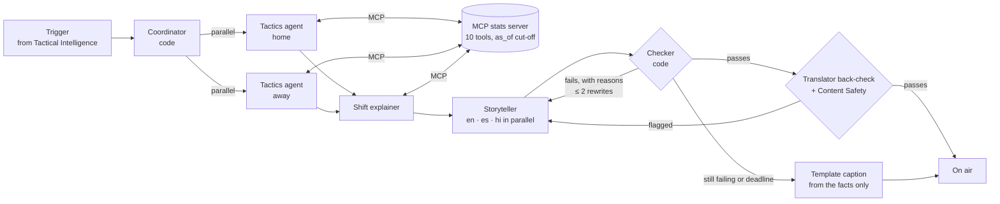

# Insight Generation: a multi-agent studio that can't invent a number

OffBall's Insight Generation turns tactical moments into short on-screen captions for four kinds of
viewer in three languages, while the match plays. A team of agents writes them; code checks every
number before anything goes on air.

The design is in [lld-insight-generation.md](design/lld-insight-generation.md); deviations are in
[VERSION.md](../VERSION.md) v2.6.0–v2.9.0.

## What it does

Tactical Intelligence watches player positions and raises a **trigger** when something worth
explaining happens: a goal or red card (a crux), a team changing its shape, a 15-minute check-in,
the confirmation four minutes after a crux. For each trigger, Insight Generation writes **one
insight with 12 captions**:

| Viewer type | Style |
|---|---|
| Analyst | Numbers and tactics, ≤ 30 words |
| Casual | Plain words, one idea, ≤ 18 words |
| Home supporter / Away supporter | The same facts, framed from that club's side, ≤ 22 words |

…each written directly in **English, Spanish and Hindi**, not machine-translated.

It predicts, then confirms. At 70' a red card produces *"Expect Northgate United to drop deeper
(line now 33.8 m)"*. At 74' the confirmation reads *"After the 70' red card to Hale Thorne,
Northgate United pulled their defensive line from 33.8 m → 25.9 m and reorganised 3-5-2 → 4-4-2;
possession 51% → 58%."*

## The agent team



| Agent | Kind | Tools | Budget | Writes |
|---|---|---|---|---|
| Coordinator | Code | – | – | The plan: which tactics agents run, the deadline (8 s for expect, 20 s otherwise) |
| Tactics agent × 2 | gpt-5-mini | 9 team tools over MCP | 2 calls, both in one turn | Findings for one team: what changed, by how much, vs. normal |
| Shift explainer | gpt-5-mini | `compare_periods`, `get_normal_style` | 2 calls | One English insight sentence with evidence IDs |
| Storyteller | gpt-5-mini, 3 calls in parallel | none | – | 4 captions per language |
| Checker | Code | – | – | Pass, or a rewrite request with the exact reasons |

Each agent has one job, its own tools and its own budget. Code does the parts that must be
deterministic (planning, checking); models do the parts that need language. The two tactics agents
work in parallel, one per team, and the storyteller writes the three languages in parallel. For
expect insights the coordinator skips the tactics agents to hold the 8-second deadline; they check
the prediction four minutes later.

## Why the numbers can be trusted

Rule 3 of the project: **code computes every number; agents only explain.**

1. **Numbers only through MCP.** Agents read statistics only through our MCP stats server
   (`mcp_stats/`): line height, pressing, style, formation, period comparison, normal style,
   passing network, chance routes, recent events, match state. Every answer carries the window or
   event IDs it came from.
2. **No peeking at the future.** An Agent Framework function middleware overwrites `as_of` on
   every tool call with the trigger's moment, so a model can't ask about minute 80 at minute 74. It
   also enforces each agent's tool budget and records every tool result.
3. **A code checker** (`insights/checker.py`) reads every caption and rejects:
   - any number not in the trigger's facts or this run's tool results (digits, or number words in
     English, Spanish and Hindi), with tolerances for rounding;
   - shares written as percentages ("0.66%" for 66%), and pitch coordinates;
   - a claim of change that the evidence doesn't show ("pressing rose" when it fell), and a rise or
     fall word that contradicts its own before → after numbers;
   - an expect caption that states a target ("drop to 33.8 m") instead of today's level;
   - jargon like "xG/10", and captions over the word limit.
4. **Translator back-check.** Spanish and Hindi captions are translated back to English with Azure
   AI Translator and checked again by the same rules.
5. **Content Safety.** Every caption is screened by Azure AI Content Safety.
6. **Rewrite, then fall back.** A failed caption goes back to the storyteller with the reasons, at
   most twice. If it still fails, or the deadline fires, **that one caption** is replaced by a
   template written from the facts alone, and is marked `auto` on screen; agent captions are marked
   `AI`.

## Results

Three recorded matches (red card, comeback, switch): 110 triggers.

| Measure | Result |
|---|---|
| Insights written by the agent team | 98 / 110 |
| Captions written by agents (after checking) | 941 / 1320 (71%); the rest are template fallbacks |
| Unchecked numbers on air | 0: every caption either passed the checks or is a template |
| Expect insights | median 8.0 s (deadline 8 s) |
| Other insights | median 20 s (deadline 20 s) |
| MCP tool calls | 175 |

What the checker sent back for rewriting, and in the end replaced, in those runs:

| Final reason a caption fell back | Count |
|---|---|
| Deadline reached | 76 |
| A claim of change the evidence doesn't show | 41 |
| Jargon ("xG/10") | 15 |
| Over the word limit | 11 |
| Rise or fall word contradicting its own numbers | 8 |

**Live on Azure:** a random match played through match control at 10× produced 46 triggers and 46
insights with 0 errors, on air about 8 s (expect) to 20 s after each trigger.

Real captions from the red-card match (agent-written, checked):

> **Analyst (en):** Northgate United pressing fell 4.84 → 1.93 presses/min after Riverside
> Athletic’s 23' goal; defensive line unchanged at 30.0 m. Possession 50% → 31%, xG per 10 minutes
> 1.86 → 0.0.
>
> **Home supporter (en):** Riverside Athletic forced Northgate United to drop deep after the red
> card; they now have 58% possession but are compact and defensive.
>
> **Casual (es):** Tras la roja, Northgate United se metieron atrás y han tenido más balón (51% → 58%).
>
> **Casual (hi):** लाल कार्ड के बाद Northgate United पीछे खींचा और कब्ज़ा 51% → 58% बढ़ा।

## Microsoft technology used

| Technology | Use |
|---|---|
| Microsoft Agent Framework | Agents, MCP tool integration (`MCPStdioTool`), function middleware for `as_of`, budgets and grounding |
| Microsoft Foundry (Azure AI Services) | `gpt-5-mini` deployment, keyless via Entra ID |
| Model Context Protocol | Our stats server, usable by any MCP client (GitHub Copilot, VS Code) |
| Azure AI Translator | Back-translation of Spanish and Hindi captions for checking |
| Azure AI Content Safety | Screening every caption |
| Azure Container Apps | The live insights service and its captions page |
| Azure Event Hubs | Triggers and Tactical Intelligence's windows arrive on the `triggers` and `stats` hubs |
| Azure Cosmos DB | Events and pre-match info for the facts |
| Managed identities | `id-insights` with read-only roles; no keys anywhere |

## Limits, honestly

- Insights are kept in the live service's memory; a restart clears the page (Cosmos storage is
  next).
- No crash recovery from checkpoints, no half-time and full-time recaps, no Foundry tracing yet.
- Predictions in expect captions aren't cross-checked between languages: in one red-card expect,
  the Spanish caption said the team would press less and the Hindi one said more.
- One live match at a time: the model deployment's rate limit is shared.
- Deviations from the design: expect skips the tactics agents (deadline); the coordinator and
  checker are code only; Spanish gets 20% longer word limits; "normal style" is the team's own
  minutes 5–15 of this match.

## Run it

```sh
# Templates only, no Azure
python -m insights.local --feeds local_feeds/m001/feeds --match m001
# The agent team (az login with access to offball-ai-kr2610), written into the viewer's replay
python -m insights.local --feeds local_feeds/m001/feeds --match m001 --agents \
    --replay web/public/replays/m001.json
# The MCP stats server on its own (stdio)
OFFBALL_MATCH_DATA=local_out/m001/insights/data python -m mcp_stats.server
# Tests
python -m pytest tests/insights
```

Live: https://offball-insights.whitemoss-2f18829c.westus2.azurecontainerapps.io (start
`offball-engine` and `offball-insights`, then press Play on match control with a new random seed).
